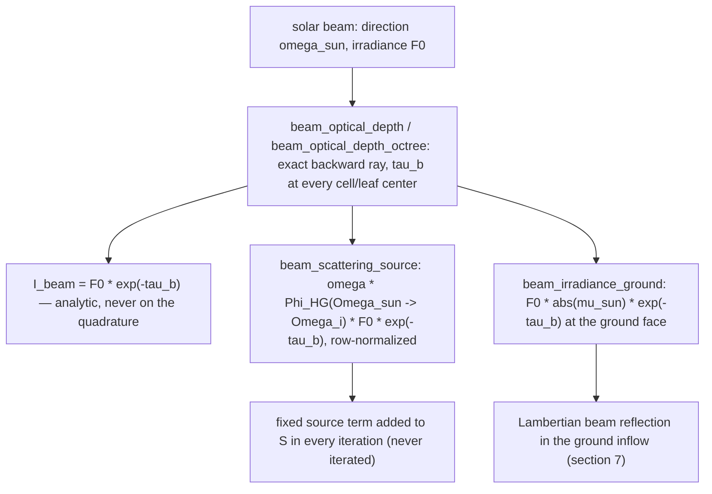
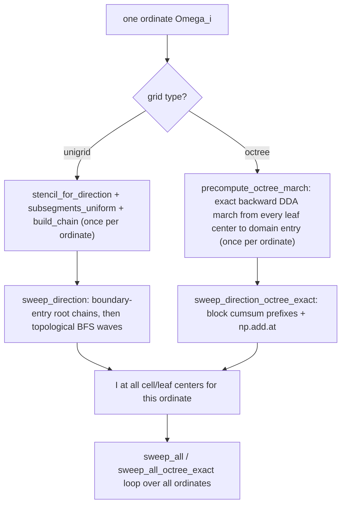
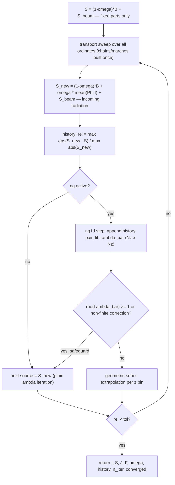
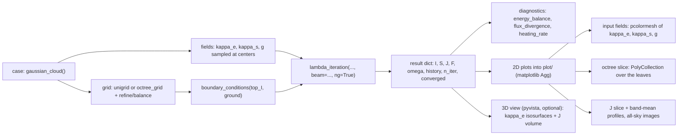
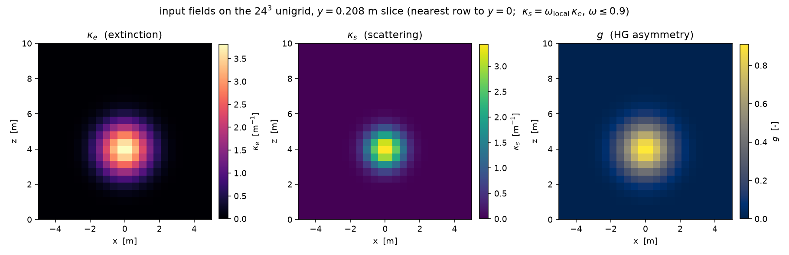
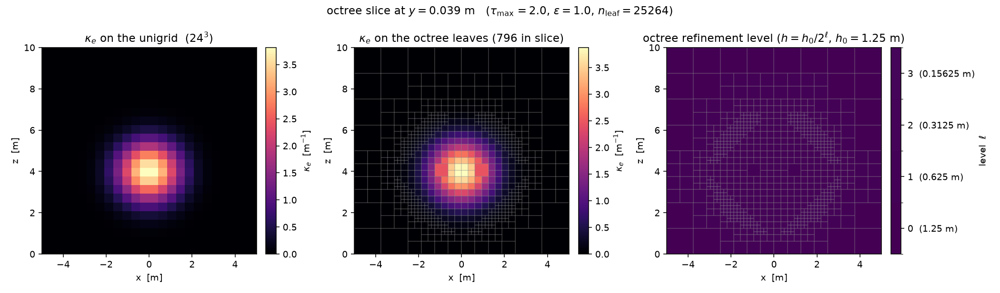
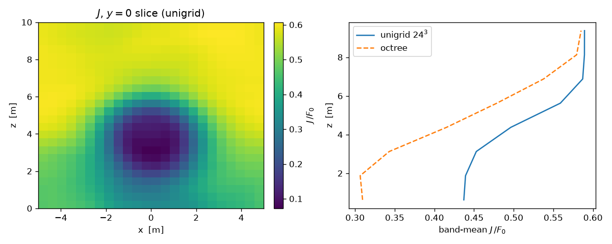
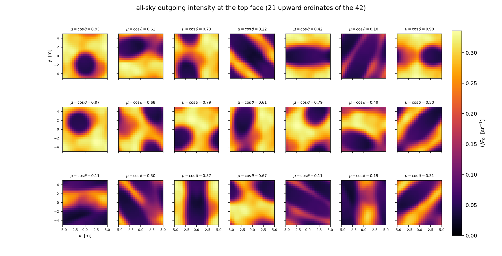
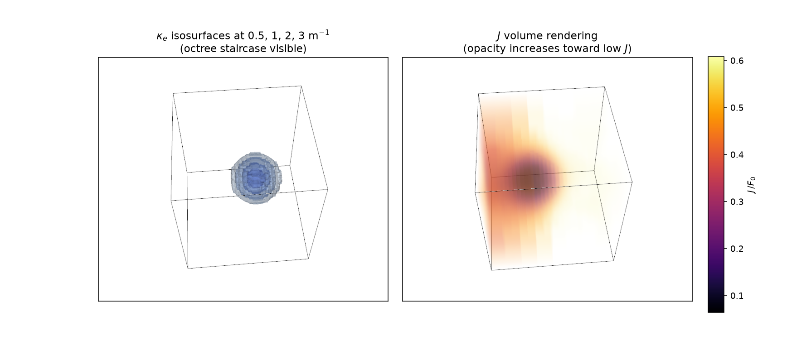

# MANUAL.md — 3d_rt_sandbox

User manual for **`rt3d`**, a 3D all-sky, monochromatic short-characteristics
radiative-transfer solver written in pure NumPy.

This manual documents the **actual code** in `rt3d/` (phases 0–6 complete,
110 tests green). The agreed design and the decisions log live in
[`plan/plan.md`](plan/plan.md) — that file stays the source of truth for *why*
a decision was made; this manual explains *what the code does and how to use
it* and cross-references the plan instead of duplicating the log.

**Contents**

- [Part I — Theory](#part-i--theory)
  1. [Scope and physical assumptions](#1-scope-and-physical-assumptions)
  2. [Governing equation](#2-governing-equation)
  3. [The solar beam split](#3-the-solar-beam-split)
  4. [Angular discretization — icosahedral direction grids](#4-angular-discretization--icosahedral-direction-grids)
  5. [Spatial discretization — unigrid and octree](#5-spatial-discretization--unigrid-and-octree)
  6. [Short-characteristics transport](#6-short-characteristics-transport)
  7. [Boundary conditions](#7-boundary-conditions)
  8. [Iteration scheme and 1D Ng acceleration](#8-iteration-scheme-and-1d-ng-acceleration)
- [Part II — Usage](#part-ii--usage)
  9. [Environment setup](#9-environment-setup)
  10. [Module tour](#10-module-tour)
  11. [Worked end-to-end example](#11-worked-end-to-end-example)
  12. [Runner scripts](#12-runner-scripts)
  13. [Condensed API reference](#13-condensed-api-reference)
  14. [Validation anchors](#14-validation-anchors)
  15. [Known limitations and performance](#15-known-limitations-and-performance)

---

# Part I — Theory

## 1. Scope and physical assumptions

`rt3d` solves the **scalar radiative transfer equation (RTE)** in a 3D
rectangular domain under the following fixed physical assumptions (plan
section 1; do not change them without updating `plan/plan.md`):

| Assumption | Meaning in the code |
|---|---|
| **Monochromatic** | One frequency at a time. All intensities, $B$, $B_g$, $F_0$ are values at the working frequency. No line structure, no frequency coupling. |
| **LTE** | Local source function $S = (1-\omega)B + \omega J$ (plus scattering anisotropy, see §2). |
| **Scalar RTE** | No polarization. The Stokes machinery in `scripts/icosphere_grid.py` (`rotater_mat`, `rotatepoles`) is legacy and unused. |
| **No refraction** | Rays are straight lines; the DDA marches of `rt3d/geometry.py` and `rt3d/octree.py` traverse straight rays. |
| **Henyey–Greenstein phase function only** | The only scattering phase function; asymmetry parameter $g$ may be scalar or per-cell. |
| **Periodic x and y** | Rays exiting a side face re-enter the opposite face (`periodic_box` argument throughout). |
| **Top = space, bottom = flat ground** | Top inflow is a constant background `top_I` (default 0); the bottom face may carry a Lambertian + emissive ground (`ground_surface`). |
| **Solar radiation as a direct beam** | A collimated beam in one direction, handled separately from the diffuse field (§3). |

The spatial domain is an axis-aligned **cuboid** (`rt3d.geometry.cuboid`):
$z = z_1$ is space (top), $z = z_0$ is the ground plane (bottom), $x$ and $y$
wrap periodically.

## 2. Governing equation

For monochromatic intensity $I(\mathbf{r}, \boldsymbol{\Omega})$, LTE,
scalar RTE:

$$
\boldsymbol{\Omega}\cdot\nabla I(\mathbf{r},\boldsymbol{\Omega})
\;+\; \kappa_e(\mathbf{r})\, I(\mathbf{r},\boldsymbol{\Omega})
\;=\; \kappa_s(\mathbf{r}) \oint \Phi_{\mathrm{HG}}(\boldsymbol{\Omega}'\to\boldsymbol{\Omega})\, I(\mathbf{r},\boldsymbol{\Omega}')\, d\Omega'
\;+\; \kappa_a(\mathbf{r})\, B(\mathbf{r})
$$

with the derived quantities **always computed, never stored as inputs**
(AGENTS.md input conventions):

$$
\kappa_a = \kappa_e - \kappa_s
\qquad\text{(absorption coefficient)},
\qquad
\omega = \frac{\kappa_s}{\kappa_e}
\qquad\text{(single scattering albedo)}
$$

$\omega$ is computed by `rt3d.source.single_scattering_albedo` with a
**vacuum guard**: where $\kappa_e = 0$ (vacuum cells) the division is skipped
and $\omega = 0$ is used, so vacuum cells neither scatter nor absorb.

The **Henyey–Greenstein** phase function (`rt3d.directions.hg`) is
normalized so that its exact integral over solid angle is 1:

$$
\Phi_{\mathrm{HG}}(\cos\Theta)
= \frac{1-g^2}{4\pi\left(1+g^2-2g\cos\Theta\right)^{3/2}},
\qquad -1 < g < 1
$$

where $\Theta$ is the scattering angle between incoming $\boldsymbol{\Omega}'$
and outgoing $\boldsymbol{\Omega}$. With
$S = (1-\omega)B + \omega\oint \Phi\, I\, d\Omega'$ the RTE takes the form

$$
\frac{dI}{ds} = \kappa_e\left(S - I\right)
$$

along a ray, which is the form the transport recursion of §6 integrates
exactly.

## 3. The solar beam split

The incoming solar radiation is a **direct beam**: a collimated bundle in one
unit direction $\boldsymbol{\Omega}_{\mathrm{sun}}$ (must have
$\Omega_{\mathrm{sun},z} < 0$) with irradiance $F_0$ at the domain top. A
direction-delta distribution
$I_{\mathrm{beam}} \propto \delta(\boldsymbol{\Omega}-\boldsymbol{\Omega}_{\mathrm{sun}})$
**cannot live on the icosahedral quadrature** of §4 — no ordinate carries it,
and projecting it onto the ordinates would corrupt the scattering integral.
The solver therefore splits

$$
I = I_{\mathrm{diff}} + I_{\mathrm{beam}}
$$

and treats the two parts separately:



1. **Beam sweep (no angular quadrature).** The beam intensity at every cell
   center is the analytic

   $$
   I_{\mathrm{beam}}(\mathbf{r}) = F_0\, e^{-\tau_b(\mathbf{r})},
   \qquad
   \tau_b(\mathbf{r}) = \int_{\mathrm{entry}}^{\mathbf{r}} \kappa_e\, ds
   $$

   where the beam optical depth $\tau_b$ is accumulated along the *exact*
   backward ray from each cell center to the domain entry point:
   `rt3d.transport.beam_optical_depth` (unigrid) and
   `beam_optical_depth_octree` (octree). The beam is never transported on the
   ordinate set.

2. **First-scattering source (fixed, never iterated).** The beam is scattered
   once into the diffuse field, contributing to the source function

   $$
   S_{\mathrm{beam}}(\mathbf{r},\Omega_i)
   = \omega(\mathbf{r})\,\Phi_{\mathrm{HG}}(\boldsymbol{\Omega}_{\mathrm{sun}}\to\Omega_i)\,
     F_0\, e^{-\tau_b(\mathbf{r})}
   $$

   (`rt3d.source.beam_scattering_source`). This term is a *fixed* source
   contribution: it is added to $S$ in every iteration but never rebuilt from
   an iterated intensity, because the beam itself is converged analytically
   from the start.

3. **Beam first-scatter HG row normalization.** The phase-function row
   $\Phi_i = \Phi_{\mathrm{HG}}(\boldsymbol{\Omega}_{\mathrm{sun}}\to\Omega_i)$
   is rescaled so that $\sum_i w_i \Phi_i = 1$ exactly — the same discrete
   quadrature convention as the row-normalized scattering matrix (§4).
   Without it, the beam first-scatter power passing through a coarse ordinate
   set would carry the raw HG quadrature error (at 42 ordinates and $g = 0.952$
   the raw sum is ≈ 0.27, i.e. a factor ~3.7 error).

The ground also sees the beam: its Lambertian reflection
$A_g F_0 |\mu_{\mathrm{sun}}| e^{-\tau_{b,\mathrm{ground}}}/\pi$ is part of
the fixed ground inflow (§7).

## 4. Angular discretization — icosahedral direction grids

The direction grid is **always** an icosahedral (geodesic) grid — never a
polar/azimuthal product grid. Construction (`rt3d.directions`):

- base icosahedron (12 vertices, 20 spherical triangles),
- geodesic refinement: bisect every edge, project to the sphere, split each
  triangle into four (vectorized edge-indexed implementation; replaces the
  $O(N^2)$ dedup loops of `scripts/icosphere_grid.py`),
- $N_{\mathrm{dir}} = 10\cdot 4^{n_{\mathrm{refine}}} + 2$ →
  **12 / 42 / 162 / 642** ordinates for
  $n_{\mathrm{refine}} = 0 / 1 / 2 / 3$.

**42 ordinates ($n_{\mathrm{refine}} = 1$) is the development grid**: all
development, test cases, benchmarks and validation runs use it.
$n_{\mathrm{refine}}$ is configurable everywhere
(`icosahedric_grid(n_refine=...)`) and recorded in every output file; no code
assumes a specific $N_{\mathrm{dir}}$. Levels 162/642 belong to the phase 6
convergence study.

**Solid-angle weights** come from **spherical-triangle areas**, not $4\pi/N$:
each triangle's spherical excess (L'Huilier's formula) is split equally among
its three corner vertices (`solid_angle_weights`). Icosphere vertices are not
equal-area, so this distinction matters. The weights satisfy
$\sum_i w_i = 4\pi$ to machine precision (validation anchor 1).

**Equator guard.** On construction the grid is rotated about a generic axis
(`direction_grid._rotate_off_poles`) so that **no ordinate has exactly
$\Omega_z = 0$**. Ordinates with $\Omega_z = 0$ form cyclic characteristics
under x/y periodicity (a ray never reaches the top or bottom boundary). The
guard is $\min_i|\Omega_z| > 10^{-6}$; measured $\min_i|\Omega_z|$ is
0.42 / 0.105 / 0.034 / 0.013 for 12 / 42 / 162 / 642 ordinates.

**Precomputed HG matrix.** The scattering integral over *all* cells is one
BLAS matmul `(n_cells × N_dir) @ (N_dir × N_dir)`.
`direction_grid.hg_matrix(g)` returns
$W_{ij} = \Phi_{\mathrm{HG}}(\Omega_j\to\Omega_i)\, w_j$ (weights of the
*incoming* direction folded in).

**Row normalization and why.** The analytic HG function integrates to 1 over
the sphere, but the coarse icosahedral quadrature breaks this at large $g$:
at 42 ordinates and $g = 0.952$ the raw weighted row sums are **16.9–21.6**
(not 1). The λ-iteration scattering operator then has spectral radius ≫ 1 —
it is *supercritical* and the iteration diverges for $\omega$ not far below 1.
`hg_matrix(g, normalize=True)` (the default) rescales each row so that
$\sum_j W_{ij} = 1$ exactly. This enforces exact discrete conservation of
isotropic radiation; at $g = 0$ the raw row sums are already exactly 1, so
isotropic results are unchanged. The same convention is used for the beam
first-scatter row (§3). The price is a modified discrete phase function; the
angular error it introduces is part of the 42-ordinate error budget (§15).

## 5. Spatial discretization — unigrid and octree

Two spatial grids, both exposing cell/leaf centers, boxes and O(1) point
location to the transport:

**`rt3d.geometry.unigrid`** — uniform Cartesian lattice defined by
cell-center coordinate arrays $x, y, z$. Cell $(i, j, k)$ has flat index
$k\, n_y n_x + j\, n_x + i$ ($i$ fastest); the domain box extends half a cell
beyond the outermost centers. A single-cell dimension gets a nominal unit
width, so a plane-parallel slab is $n_x = n_y = 1$ with periodic sides.

**`rt3d.octree.octree_grid`** — flat struct-of-arrays octree over the cuboid,
built from cubic base cells of size $h_0$ (must divide all side lengths),
cubic cells, max-depth cap, node arrays `centers_all / half_all /
level_all / children_all`. Leaf-indexed public arrays (`centers`, `half`,
`level`, `kappa_e`, `kappa_s`, `g`, `T`) are frozen by `finalize()`.

**Refinement criteria** (`octree_grid.refine`, driven by the *input*
extinction field, sampled at the 8 cell corners):

$$
\kappa_{e,\max}\,\Delta x > \tau_{\max}
\qquad\text{(optical depth per cell)}
$$

$$
\frac{\kappa_{e,\max}-\kappa_{e,\min}}{\langle\kappa_e\rangle} > \varepsilon_{\mathrm{grad}}
\qquad\text{(cloud edges)}
$$

The gradient criterion is applied **only where the cell is not effectively
transparent**, gated by
$\kappa_{e,\max}\,\Delta x > 10^{-2}\,\tau_{\max}$.
Rationale: in the vacuum tails of a cloud the *relative* $\kappa_e$ gradient
is large but physically irrelevant — without the floor the octree would
refine the exponentially small Gaussian tails down to the depth cap.

**2:1 face balance** (`balance_21`): a leaf may differ from any face neighbor
by at most one level. Each face is probed at a **3×3 grid** of points
(transverse offsets $-h/2, 0, +h/2$), which is guaranteed to hit a deeper
neighbor of any allowed size; the loop repeats until no splits remain.

**O(1) point location** (`locate`): vectorized descent from the base lattice
(`floor` to base cell, then octant selection per level) — no per-level dense
tables.

**Why the solver uses exact characteristics on the octree.** The phase-3
reference implementation (`characteristics.build_chain_octree`) connects each
leaf to the *best-aligned center-to-center predecessor* (the octree analogue
of the unigrid lattice stencil, §6). In heterogeneous 3D fields its hop
alignment tolerance makes the **path error scale-invariant**: on the Gaussian
cloud the characteristic $\tau$ error stays ≈ 4 no matter how much the grid
is refined — refining the grid does not converge the ray path. The solver
therefore uses **exact characteristics** instead:
`transport.precompute_octree_march` marches one ray *backwards from every
leaf center along $-\boldsymbol{\Omega}$ to the domain entry point* (DDA
through the octree, `octree.march_octree`), once per ordinate, and reuses the
segments in every iteration. The only remaining path error is the octree's
own resolution of the piecewise-constant field. On the unigrid the
lattice-stencil chain is kept (its error is the documented anchor-5 effect,
§14).

## 6. Short-characteristics transport

> Detailed derivation, flowcharts and schematic figures for both grids:
> [`docs/sc-transport.md`](docs/sc-transport.md) (figures generated by
> `scripts/sc_transport_figures.py` into `plot/`).

One characteristic per cell/leaf center per ordinate. Along a characteristic
the medium is piecewise constant per traversed cell, and the formal solution

$$
I_c = I_u\, e^{-\tau_{\mathrm{tot}}}
\;+\; \sum_{\mathrm{sub}} S_{\mathrm{sub}}\,
       \left(1 - e^{-\tau_{\mathrm{sub}}}\right)\,
       e^{-\tau_{\mathrm{after}}}
$$

($\tau_{\mathrm{sub}}$ = optical depth of sub-segment *sub*,
$\tau_{\mathrm{after}}$ = optical depth between that sub-segment and the
target center) is **exact** for piecewise-constant sources. The code uses
`-expm1(-tau)` for $1 - e^{-\tau}$ accuracy at small $\tau$.



**Unigrid (`characteristics.build_chain` + `transport.sweep_direction`).**
For one ordinate $\boldsymbol{\Omega}$ the upwind cell of $c$ is $c - s$ with
a single integer **lattice stencil** $s$ per ordinate
(`stencil_for_direction`: the offset with $s_z \neq 0$ whose lattice
direction $s\cdot h$ is closest to $\boldsymbol{\Omega}$; the search radius
auto-scales with grid anisotropy, $\sim 3\max(h)/\min(h)$). The straight path
$u_{\mathrm{center}} \to c_{\mathrm{center}}$ is split into **explicit
sub-segments** (`subsegments_uniform`) whose relative offsets and lengths are
the *same* for every cell. Since $s_z \neq 0$ always (§4 equator guard) and
$z$ is the only non-periodic dimension, every chain terminates at a
z-boundary: the dependency graph is a forest, processed in **topological BFS
waves** (`chain["waves"]`) — each wave is a handful of vectorized gathers.
Chain roots carry an exact backward march (`march_lattice`) from the root
center to the domain entry point.

**Octree (`transport.precompute_octree_march` +
`sweep_direction_octree_exact`).** Segments of each backward ray are stored
ray-contiguous (`leaf`, `length`, `offsets`, ordered *center → entry*). The
recursion is then fully vectorized: per-segment optical depths
$\tau_{\mathrm{seg}} = \kappa_e[\mathrm{leaf}]\cdot \ell$, block-wise
cumulative sums via `_block_prefixes` (a single `np.cumsum` plus per-block
offset correction — the "cumsum vectorization"), and `np.add.at` accumulation
onto leaf centers. The march depends only on grid + direction, so it is built
once per ordinate and reused by every iteration.

`transport.sweep_all` / `sweep_all_octree_exact` loop over all ordinates;
the source $S$ may be direction-dependent (`(n_cells, N_dir)`), which is what
anisotropic scattering requires.

## 7. Boundary conditions

`rt3d.transport.boundary_conditions` holds constant background intensities
`top_I`, `bottom_I`, `side_I` (sides ignored when periodic) plus an optional
`ground`:

- **Top:** $I_{\mathrm{diff}} = \texttt{top\_I}$ (default 0 = space) for
  ordinates entering through $z = z_1$.
- **Bottom without ground:** $I_{\mathrm{diff}} = \texttt{bottom\_I}$.
- **Lambertian + emissive ground** (`ground_surface(albedo, emissivity, B_g,
  height=...)`): upward ordinates entering through the bottom face get the
  ground radiance

  $$
  I_{\uparrow}
  = \varepsilon_g\, B_g
  + \frac{A_g}{\pi}\left(
      F_{\downarrow}
      + F_0\,|\mu_{\mathrm{sun}}|\,e^{-\tau_{b,\mathrm{ground}}}
    \right),
  \qquad
  F_{\downarrow} = \sum_{\Omega_z < 0} w\,|\Omega_z|\, I
  $$

  where $F_{\downarrow}$ is the downward irradiance at ground level (rebuilt
  from the just-swept downward ordinates every iteration), and the last term
  is the **Lambertian reflection of the solar beam** (fixed part).
  Monochromatic convention: $B_g$ is the Planck value at the working
  frequency, given as an input like every other $B$.

  ```mermaid
  flowchart LR
      A["sweep all downward ordinates (Omega_z negative)"] --> B["downward_irradiance: F_down at ground level"]
      B --> C["assemble ground radiance: eps_g*B_g + A_g*(F_down + beam)/pi"]
      C --> D["sweep all upward ordinates (Omega_z positive) with bottom_I = ground radiance at each ray entry point"]
  ```

  In the solver loop the **downward ordinates are swept first**, the ground
  radiance is assembled, then the upward ordinates are swept with that
  per-entry-point inflow (`bottom_I=` argument of the sweeps; on the octree
  the entry leaf comes from `march["entry_cell"]`, on the unigrid the $k = 0$
  ground radiance tiles over all layers because chains with $|s_z| > 1$ root
  above the bottom layer).
- **Periodic sides:** implemented in the ray marches
  (`geometry.march_lattice`, `octree.march_octree`) as ray exit→entry wrap:
  a ray crossing a periodic x/y face is wrapped (`cuboid.wrap_xy`) and keeps
  marching; only top/bottom exits terminate it.
  *Wrap-stall bugfix note:* a ray that exits exactly (or within float noise)
  on a periodic face would be mapped by `mod()` back **onto the same face**,
  re-exit immediately with a zero-length step, and stall the march until
  `max_steps` without ever recording an exit. `march_lattice` therefore snaps
  such points to the *opposite* face (see the comment block in
  `geometry.march_lattice`).
- **Variable surface hook:** `ground_surface(height=f(x, y))` is accepted
  (`is_variable()`), but the transport supports only a flat ground at the
  domain bottom — `lambda_iteration` raises `NotImplementedError` for a
  variable surface (phase 6 hook, see §15).

## 8. Iteration scheme and 1D Ng acceleration

The solver (`rt3d.solver.lambda_iteration`) is structured like DOIT
(compute incoming radiation → transport → next iteration):



The initial source is $S^{0} = (1-\omega)B + S_{\mathrm{beam}}$ (fixed parts
only — no radiation yet). The convergence history measures
$\max|S^{\mathrm{new}} - S| / \max|S^{\mathrm{new}}|$ — the plain-LI residual
of the *swept* source, also when Ng is active.

**1D Ng acceleration (`rt3d.accelerator.ng1d`).** Ng (1982) acceleration with
a plane-averaged ($z$) estimate of the scattering operator $\bar{\Lambda}$
(plan section 5). It needs **no extra transport sweeps**: the λ-iteration
iterate differences themselves probe $\bar{\Lambda}$. With $\sigma^n$ the
source *actually swept* at iteration $n$ and
$S^{n+1} = \Lambda\,\sigma^n + Q$ the plain-LI update ($Q$ = fixed source
parts), the history pairs

$$
x^{(m)} = \sigma^{m} - \sigma^{m-1},
\qquad
y^{(m)} = \Lambda\,\sigma^{m} - \Lambda\,\sigma^{m-1}
        = S^{m+1} - S^{m}
\qquad (Q \text{ cancels})
$$

satisfy $\bar{\Lambda}\, x^{(m)} = y^{(m)}$ exactly for the 1D operator.
$\bar{\Lambda} \in \mathbb{R}^{N_z \times N_z}$ is the minimum-norm
least-squares fit of the **horizontally plane-averaged** pairs
(`plane_average`: unigrid — one bin per z layer; octree — one bin per base
cell z level, leaves weighted by their horizontal cross-section). The
accelerated source is the geometric-series extrapolation

$$
\sigma^{n+1} = S^{n+1} + \left(I - \bar{\Lambda}\right)^{-1}\bar{\Lambda}\, d^{n+1},
\qquad
d^{n+1} = S^{n+1} - \sigma^{n}
$$

applied per z bin. (Scalar check: for $\Lambda = \lambda$ this reproduces the
fixed point in one step.)

Two subtleties encoded in the code:

- **Swept-source / consecutive-update pairing.** $x$ must be the difference
  of the sources *actually swept*, and $y$ the difference of *consecutive LI
  updates* — not the naive difference of successive iterates. Once
  acceleration is active, the swept source is no longer the plain LI iterate,
  and step-difference pairing would probe $(I-A)^{-1}\Lambda$ instead of
  $\Lambda$ and break the fit.
- **Spectral-radius safeguard.** A bad fit with
  $\rho(\bar{\Lambda}) \geq 1$ would make the geometric series blow up;
  `ng1d.step` checks $\max_i |\mathrm{eig}_i(\bar{\Lambda})| \geq 1$ and falls back to plain LI for
  that step (also on non-finite corrections). Warmup: `n_start = 3` history
  pairs of plain LI before acceleration starts; at most
  `max_hist = 3·Nz` pairs are kept.

The scattering part of the source is direction-averaged in the history
(scalar RTE, HG scattering ⇒ the accelerated part is isotropic), so the
history is stored as `(n_cells,)` direction-averaged vectors.

Measured iteration counts to $\mathrm{tol} = 10^{-6}$ on the
$\tau = 5$ slab, $g = 0$ (phase 4, `scripts/phase4_ng.py`):
**$\omega = 0.5$: 22 → 10, $\omega = 0.9$: 87 → 13,
$\omega = 0.99$: 178 → 14** (LI → Ng).

### Delta-M scaling (`delta_M`)

**What it is.** For strongly forward-peaked scattering ($g \gtrsim 0.5$)
the HG lobe is unresolved on the 42-ordinate grid, the effective optical
depth is overestimated by the un-split forward peak, and the
λ-iteration scattering operator converges slowly (§4). **Delta-M
(Wiscombe) scaling** subtracts the first $M$ Legendre moments of the HG
phase function (its moments are $g^n$) from the scattering operator and
reduces the *scattering part* of the extinction accordingly:

$$
\Phi_\delta(\cos\Theta)
= \Phi_{\mathrm{HG}}(\cos\Theta)
- \frac{1}{4\pi}\sum_{n=0}^{M-1}(2n+1)\,g^n P_n(\cos\Theta),
\qquad
\kappa_{e,\delta} = \kappa_e - \kappa_s\, g^M
$$

The subtracted moments are added back into the source function exactly,
together with an explicit $-\omega g^M I$ term and the scale
$1/(1 - \omega g^M)$ (`rt3d.source.scattering_source(..., delta_M=M)`),
while all diffuse transport sweeps use $\kappa_{e,\delta}$
(`rt3d.source.delta_extinction`). The split is defined on the
row-normalized `hg_matrix` via
`direction_grid.hg_delta_matrices(g, M)`, so
`Phi_w == Phi_w_delta + sum(moments)` holds exactly as matrices —
delta-M changes the iteration and the transport scaling, **not the
converged discrete solution** (§4). The reduced diffuse extinction
shortens the effective mean free path per scattering event, so the
λ-iteration contracts far faster at large $g$.

**How to use it.** Pass `delta_M=1` to `lambda_iteration` (default
`delta_M = 0` = off). The phase runner scripts have a `DELTA_M = 0`
config cell (`scripts/phase2_slab.py`, `scripts/phase4_ng.py`,
`scripts/phase6_directions.py`). $M = 1$ (delta-Eddington) is the
recommended, validated choice; $M = 2$ is implemented and tested as
well.

**When to use it.** $g \gtrsim 0.5$ — where the HG lobe is unresolved
and plain LI suffers (the Gaussian cloud core has $g \approx 0.952$).
At small $g$ delta-M can *slow* Ng-accelerated runs (table below), so
leave it off for $g \lesssim 0.5$.

**What it does not change.**

- **The converged solution.** Delta-on and delta-off converge to the
  same discrete solution up to the $O(\tau_{\mathrm{cell}})$
  short-characteristics quadrature error of the explicit
  $-\omega g^M I$ term — measured on the $\tau = 5$ slab: max relative
  $\Delta J$ 3.9e-2 ($n_z = 8$) → 9.2e-3 ($n_z = 16$) → 2.1e-3
  ($n_z = 32$), shrinking ~linearly with cell size (agreement on the
  same solution, not an inconsistency).
- **Beam attenuation.** $\tau_b$ and the ground beam irradiance keep
  the **physical** $\kappa_e$ (the beam is not on the quadrature; the
  moment subtraction applies to the diffuse field only, §3). Only the
  first-scatter albedo factor becomes
  $\omega/(1 - \omega g^M)$ in `beam_scattering_source`.
- **Octree refinement.** Still driven by the physical $\kappa_e$ — it
  runs outside the solver (§5).
- **Validation anchors.** Anchor 3 (exact Beer–Lambert at
  $\kappa_s = 0$) holds with delta on — this is *why* only the
  scattering part of the extinction is scaled: full-extinction scaling
  $\kappa_e (1 - g^M)$ breaks anchor 3 at $O(\tau_{\mathrm{cell}})$ and
  makes plain LI diverge for $\omega < g^M$ (plan decisions log,
  `plan/delta-m-plan.md`).

Measured iteration counts on the $\tau = 5$ slab, $n_z = 16$,
$\omega = 0.9$, $\mathrm{tol} = 10^{-8}$, 42 ordinates (plain LI →
delta-M $M=1$, Ng → Ng + delta-M $M=1$):

| $g$ | plain LI | Ng |
|---|---|---|
| 0.5 | 75 → 45 | 31 → **59** (slower) |
| 0.8 | 67 → 22 | — |
| 0.9 | 69 → 14 | 90 → 15 |
| 0.95 | 65 → 11 | 82 → 11 |

($M = 2$ at $g = 0.9$: 77 → 23 plain LI; the regression test
`tests/test_delta_m.py::test_solver_acceleration_delta_M1` at
$n_z = 8$, $\mathrm{tol} = 10^{-6}$, $g = 0.95$: 62 → 12.)

---

# Part II — Usage

## 9. Environment setup

Mamba/conda environment **`pyarts`**. There is no `mamba`/`conda` on `PATH`
in a plain shell — call the environment interpreter by absolute path:

```powershell
& C:\Users\fredd\miniforge3\envs\pyarts\python.exe <script.py>
```

> **⚠ BLAS/openblas PATH gotcha — read this first.**
> The env's numpy links against the `libcblas.dll` shim, which *delay-loads*
> `openblas.dll` from `C:\Users\fredd\miniforge3\envs\pyarts\Library\bin`.
> Running the interpreter by absolute path **without activating the env**
> leaves that directory off `PATH`, and every matrix product then
> hard-crashes the process with exit code **`-1066598273`**
> (`0xC06D007F`, delay-load failure) — **no traceback**. Prepend it before
> running anything that does a matmul (which is everything in `rt3d`):
>
> ```powershell
> $env:Path = "C:\Users\fredd\miniforge3\envs\pyarts\Library\bin;" + $env:Path
> ```

Installed packages (verified):

| Package | Version |
|---|---|
| Python | 3.14.6 |
| numpy | 2.5.2 |
| scipy | 1.18.0 |
| matplotlib | 3.11.1 |
| xarray | 2026.7.0 |
| h5py | 3.16.0 |
| pyarts3 | 3.0.0.dev10 |
| pytest | 9.1.1 |

**Not installed:** `numba`, `pyvista` (verified `ModuleNotFoundError`). The
solver is pure NumPy and does not need them (§15).

Quick sanity check:

```powershell
& C:\Users\fredd\miniforge3\envs\pyarts\python.exe -c "import numpy, scipy; print(numpy.__version__, scipy.__version__)"
```

Running the test suite (110 tests, ≈ 6 min):

```powershell
$env:Path = "C:\Users\fredd\miniforge3\envs\pyarts\Library\bin;" + $env:Path
& C:\Users\fredd\miniforge3\envs\pyarts\python.exe -m pytest tests -q
```

`tests/conftest.py` puts the repo root on `sys.path`, so `import rt3d` works
from the repo root in scripts and tests alike. Plots must not block: use
`matplotlib.use("Agg")` and `fig.savefig("plot/...")`; figure output goes to
`plot/`.

## 10. Module tour

One section per `rt3d` module, with the real signatures.

### `rt3d.directions` — direction grids and HG matrices

- `make_icosahedric_grid() -> (vertices (12,3), triangles (20,3))` — base
  icosahedron (same construction as `scripts/icosphere_grid.py`).
- `refine_icosahedric_grid(vertices, triangles, n_refine=1) -> (vertices, triangles)`
  — vectorized geodesic refinement (edge-indexed midpoint table; exact, fast
  enough for $n_{\mathrm{refine}} = 3$).
- `solid_angle_weights(vertices, triangles) -> weights (N,)` — per-vertex
  solid angles from spherical-triangle areas (L'Huilier);
  $\sum w = 4\pi$.
- `hg(cos_theta, g) -> Phi` — HG phase function,
  $\oint\Phi\,d\Omega = 1$ analytically.
- `class direction_grid(n_refine=1)` — attributes `n_refine`,
  `directions (N_dir,3)`, `weights (N_dir,)`, `triangles`,
  `down_idx` / `up_idx` (indices with $\Omega_z < 0$ / $> 0$; a partition,
  since no ordinate has $\Omega_z = 0$), property `n_dir`.
  Methods: `cos_theta() -> (N_dir,N_dir)`;
  `hg_matrix(g, with_weights=True, normalize=True) -> W` with
  $W_{ij} = \Phi_{\mathrm{HG}}(\Omega_j\to\Omega_i)\,w_j$ and unit row sums
  when `normalize=True` (§4);
  `hg_delta_matrices(g, M) -> (Phi_w_delta, moments)` — exact delta-M
  split of the row-normalized matrix,
  `moments[n][i, j] = (2n+1) g^n P_n(Omega_i . Omega_j) w_j / (4 pi)`,
  `Phi_w == Phi_w_delta + sum(moments)` (§8).
- `icosahedric_grid(n_refine=1) -> direction_grid` — the single place the
  default $n_{\mathrm{refine}} = 1$ (42 ordinates) appears.

### `rt3d.geometry` — domain, unigrid, ray marching, ground

- `class cuboid(x0, x1, y0, y1, z0, z1, periodic_x=True, periodic_y=True)` —
  properties `Lx, Ly, Lz`; `contains(points)`, `wrap_xy(points)`.
- `class unigrid(x, y, z)` — cell-center arrays; attributes `hx, hy, hz`,
  `nx, ny, nz, n_cells`, `centers (n_cells,3)` (flat-index order, $i$
  fastest), `box`. Methods `cell_box(idx)`, `unravel(idx)`, `ravel(i,j,k)`,
  `locate(points)` (O(1), clamped).
- `ray_box_exit(origin, direction, box) -> (t_exit, exit_axis, exit_side)` —
  slab-method exit distance/face for points inside a box.
- `march_lattice(origin, direction, grid, max_steps=None, periodic_box=None)
  -> (steps, exit_t, exit_axis, exit_side)` — vectorized Amanatides–Woo DDA
  of K rays sharing one direction through the unigrid; `steps` is
  step-major `(ray_idx, cell_idx, length)`; with `periodic_box`, x/y exits
  wrap and only z exits terminate (§7 incl. wrap-stall fix).
- `class ground_surface(albedo=0.0, emissivity=1.0, B_g=0.0, height=0.0)` —
  flat Lambertian + emissive ground; `height(x, y)` / `is_variable()` are
  the variable-surface hook (transport: flat only, §7).

### `rt3d.octree` — octree grid and DDA march

- `class octree_grid(cuboid, h0)` — cubic base cells, $h_0$ must divide all
  side lengths. Build: `refine(kappa_e_fn, tau_max=0.5, eps_grad=0.3,
  max_depth=6)`, `balance_21(max_depth=6)`, `finalize()` (freezes leaf
  arrays `centers, half, level, n_leaf` and allocates `kappa_e, kappa_s, g,
  T` slots); `sample_fields(kappa_e=…, kappa_s=…, g=…, T=…)` samples
  callables $(x,y,z) \mapsto$ array at leaf centers; `locate(points)`
  vectorized descent; `split(nodes)`, `leaves_all()`.
- `march_octree(origin, direction, oct, path_len, periodic_box=None) ->
  (seg_ray, seg_leaf, seg_len)` — vectorized DDA, per-ray directions and
  per-ray path-length budgets, segments in traversal order per ray.
- `node_major_segments(seg_ray, seg_leaf, seg_len, n_nodes) ->
  (seg_ray, seg_leaf, seg_len, offsets)` — regroup step-major segments into
  node-major contiguous blocks (stable sort preserves traversal order).

### `rt3d.characteristics` — predecessor chains (unigrid + octree reference)

- `stencil_for_direction(omega, h, max_offset=None) -> (s, vhat)` — integer
  lattice stencil per ordinate (§6); $s_z \neq 0$; automatic search radius
  $\min\!\big(24, \max(3, \lceil 3\max(h)/\min(h)\rceil)\big)$.
- `subsegments_uniform(s, h) -> (rel (M,3), lengths (M,))` — exact
  sub-segments of the center-to-center path on the lattice.
- `build_chain(grid, omega, periodic_box=None, max_offset=None) -> chain` —
  unigrid chain dict: `s`, `vhat`, `parent`, `roots`, `waves`,
  `sub_cells (M, n_cells)`, `sub_len`, `root_steps` (step-major backward
  march segments from root centers to entry), `root_exit_t`,
  `root_exit_axis`, `root_exit_side`. Used by the solver on the unigrid.
- `build_chain_octree(oct, omega, periodic_box=None, cos_min=0.9,
  max_hops=8) -> chain` — **reference only, not used by the solver** (§5):
  best-aligned center-to-center connection with cycle peeling; kept for
  phase-3 validation (`scripts/phase3_octree.py` cell 1).

### `rt3d.transport` — sweeps, boundary conditions, beam

- `class boundary_conditions(top_I=0.0, bottom_I=0.0, side_I=0.0, ground=None)`
  — face backgrounds + optional ground (§7); `inflow(exit_axis, exit_side)`.
- `bottom_mask(grid) -> bool array` — cells/leaves touching the bottom face.
- `downward_irradiance(I, dg) -> F_down` —
  $\sum_{\Omega_z<0} w\,|\Omega_z|\, I$ per cell (`I` restricted to
  `dg.down_idx` order).
- `ground_inflow(F_down, ground, beam_irr=0.0) -> I_up` —
  $\varepsilon_g B_g + A_g (F_{\downarrow} + \text{beam}_{\mathrm{irr}})/\pi$.
- `beam_irradiance_ground(grid, omega_sun, kappa_e, tau_b, F0, periodic_box=None)`
  — $F_0|\mu_{\mathrm{sun}}|e^{-\tau_b}$ extended through the bottom cell to
  the ground face.
- `sweep_direction(grid, chain, kappa_e, S, bc, bottom_I=None) -> I (n_cells,)`
  — one unigrid ordinate sweep (recursion of §6).
- `sweep_all(grid, direction_grid, kappa_e, S, bc, periodic_box=None, chains=None)
  -> (I (n_cells,N_dir), chains)` — all ordinates; pass prebuilt `chains` to
  reuse across iterations.
- `beam_optical_depth(grid, omega_sun, kappa_e, periodic_box=None) -> tau_b`
  — exact backward-beam $\tau$ at cell centers (unigrid); raises unless
  $\Omega_{\mathrm{sun},z} < 0$.
- `precompute_octree_march(oct, omega, periodic_box=None) -> march` —
  exact backward march per leaf center for one ordinate (§6); dict `leaf`,
  `length`, `offsets`, `ray_of`, `omega`, `entry_cell` (bottom-face leaf of
  each upward ray's ground entry point, for the ground BC).
- `sweep_direction_octree_exact(oct, march, kappa_e, S, bc, bottom_I=None) -> I`
  — one octree ordinate sweep along exact characteristics.
- `sweep_all_octree_exact(oct, direction_grid, kappa_e, S, bc,
  periodic_box=None, marches=None) -> (I, marches)` — all ordinates.
  **This is the octree transport used by the solver.**
- `sweep_direction_octree(oct, chain, kappa_e, S, bc)` and
  `sweep_all_octree(...)` — sweeps along `build_chain_octree` chains
  (reference only).
- `beam_optical_depth_octree(oct, omega_sun, kappa_e, periodic_box=None) -> tau_b`.

### `rt3d.source` — source function assembly

- `single_scattering_albedo(kappa_e, kappa_s) -> omega` — with the
  $\kappa_e \to 0$ guard (§2).
- `mean_intensity(I, dg) -> J` — $J = \frac{1}{4\pi}\oint I\,d\Omega$.
- `flux_vector(I, dg) -> F (n_cells,3)` — $F = \oint I\,\boldsymbol{\Omega}\,d\Omega$.
- `delta_extinction(kappa_e, kappa_s, g, M) -> kappa_e - kappa_s * g**M`
  — delta-M transport extinction (only the scattering part scaled;
  `M = 0` returns `kappa_e` unchanged) (§8).
- `scattering_source(I, dg, omega, B, Phi_w=None, g=0.0, beam_scat=None,
  g_cells=None, g_decimals=2, Phi_cache=None, delta_M=0) -> S (n_cells,N_dir)` —
  $S_{ic} = (1-\omega_c)B_c + \omega_c \sum_j w_j \Phi(\Omega_j\to\Omega_i) I_{cj} + \text{beam\_scat}$.
  Spatially varying $g$ (`g_cells`) is bucketed by `round(g, g_decimals)`
  with one BLAS matmul per bucket and an optional `{g: Phi_w}` `Phi_cache`
  (§2/§4). With `delta_M >= 1` the delta-M form is used instead —
  `Phi_w_delta` + moment operators + explicit $-\omega g^M I$ term, scaled
  by $1/(1 - \omega g^M)$; splits are cached under the tuple key
  `(g_value, delta_M)` (§8).
- `beam_scattering_source(dg, omega_sun, F0, tau_b, omega, g, g_cells=None,
  delta_M=0) -> S_beam (n_cells,N_dir)` — fixed beam first-scatter term
  with normalized HG row (§3); with `delta_M >= 1` the albedo factor
  $\omega$ becomes $\omega/(1 - \omega g^M)$, $\tau_b$ stays physical (§8).

### `rt3d.accelerator` — Ng acceleration

- `class ng1d(grid, max_hist=None, n_start=3)` — 1D Ng state (§8); methods
  `plane_average(v)`, `lambda_bar()` ($N_z\times N_z$ least-squares fit),
  `step(S_swept, S_new) -> next source`.

### `rt3d.solver` — the iteration loop

- `lambda_iteration(grid, dg, kappa_e, kappa_s, B, bc, g=0.0,
  periodic_box=None, beam=None, n_iter=100, tol=1e-8, ng=None,
  delta_M=0) -> result`
  — the entry point. `grid` is a `unigrid` or `octree_grid`; $g$ scalar or
  `(n_cells,)`; `beam = {"omega_sun": (3,) unit, "F0": float}` or `None`;
  `ng` is `None`/`False` (plain LI), `True` (build `ng1d(grid)`) or a
  prepared `ng1d`; `delta_M = 0` off, `>= 1` delta-M scaling (§8).
  Returns the result dict:

  | key | shape / type | meaning |
  |---|---|---|
  | `I` | `(n_cells, N_dir)` | converged center intensities (diffuse field) |
  | `S` | `(n_cells, N_dir)` | converged source function |
  | `J` | `(n_cells,)` | mean intensity |
  | `F` | `(n_cells, 3)` | flux vector |
  | `omega` | `(n_cells,)` | single scattering albedo |
  | `history` | list of float | relative source change per iteration |
  | `n_iter` | int | iterations performed |
  | `converged` | bool | `history[-1] < tol` |
  | `delta_M` | int | delta-M order used (0 = off) |
  | `kappa_e_delta` | `(n_cells,)` | extinction used for the diffuse sweeps; equals `kappa_e` when `delta_M = 0` (§8) |

  Note there is **no `SolverConfig`** class (that name exists only in
  `plan/plan.md`); all configuration is via the keyword arguments above.

### `rt3d.diagnostics` — diagnostics

- `heating_rate(kappa_a, J, B)` — net heating rate per volume,
  $4\pi\kappa_a (B - J)$ (positive = radiation gains energy from matter).
- `flux_divergence(grid, F) -> per-cell div F` — central differences,
  periodic wrap in x/y, one-sided at top/bottom (uniform unigrid only).
- `energy_balance(grid, I, dg, kappa_a, B) -> dict` — global closure on the
  unigrid: `out_top`, `out_bottom` (outward power through the faces, net
  $F_z$ second-order extrapolated from the boundary layers), `heating`
  ($\int 4\pi\kappa_a (B-J)\,dV$),
  `residual = out_top + out_bottom − heating`. With a beam, subtract the
  first-scatter input $\int \kappa_s F_0 e^{-\tau_b}\,dV$ from the residual
  to close the diffuse-field balance (§11, §14 anchor 4).
- `allsky(grid, I, dg, face="top") -> dict` — outgoing intensity images at a
  horizontal face for every leaving ordinate: `omega (n_out,3)`,
  `weights (n_out,)`, `images (n_out, ny, nx)`; `face="top"` uses upward
  ordinates at the top layer, `face="bottom"` downward ordinates at the
  bottom layer (uniform unigrid).

### `rt3d.cases` — test cases

- `gauss(x, y, z, sigma=1.0, mu=(0,0,4))` — normalized 3D Gaussian
  (integral 1), as in `scripts/class_test.py`.
- `gaussian_cloud(sigma=1.0, mu=(0,0,4), tau_column_max=10.0, omega_cap=None)
  -> case dict` — the `class_test.py` case as callables: `box`
  ($x,y \in [-5,5]$, $z \in [0,10]$) and `kappa_e`, `kappa_s`, `g`, `T`
  fields $(x,y,z) \mapsto$ array. Peak column $\tau$ 10; local $\omega$
  peaks at 1.0 (uncapped, faithful to `class_test.py`) or `omega_cap`; local
  $g$ peaks ≈ 0.952. `class_test.py` stores `albedo`; this case converts to
  $\kappa_s = \omega_{\mathrm{local}}\cdot\kappa_e$.
- Note: `slab_1d` / `clear_sky` from `plan/plan.md` **do not exist as case
  modules**; the plane-parallel slab lives inside `scripts/phase2_slab.py`.

## 11. Worked end-to-end example

Gaussian cloud + Lambertian ground + solar beam, on both grids, Ng
accelerated. The script below was **executed with the pyarts interpreter and
its output verified**; the printed numbers are the actual measured values.
Figures are written to `plot/`.

**Units.** The solver itself is unit-agnostic — it only ever sees consistent
numbers — so the example fixes a convention once: **lengths in m**, hence
$\kappa_e$ and $\kappa_s$ in m$^{-1}$, and radiative quantities normalised to
the incident beam flux $F_0 = 1$, i.e. $J/F_0$ and $I/F_0$ [sr$^{-1}$]. $g$ is
dimensionless. With `tau_column_max = 10` over the 10 m box this gives a peak
$\kappa_e \approx 3.9$ m$^{-1}$ (mean free path ≈ 0.26 m). The `scripts/phase*`
runners use the same metre convention.



```python
# gaussian_cloud_example.py — run from the repo root:
#   Windows:      $env:Path = "C:\Users\fredd\miniforge3\envs\pyarts\Library\bin;" + $env:Path
#                 & C:\Users\fredd\miniforge3\envs\pyarts\python.exe gaussian_cloud_example.py
#   macOS/Linux:  ~/miniforge3/envs/pyarts/bin/python gaussian_cloud_example.py
import time

import numpy as np

import matplotlib
matplotlib.use("Agg")
import matplotlib.pyplot as plt
from matplotlib.collections import PolyCollection
from matplotlib.colors import BoundaryNorm, Normalize

from rt3d.cases.gaussian_cloud import gaussian_cloud
from rt3d.directions import icosahedric_grid
from rt3d.geometry import unigrid, ground_surface
from rt3d.octree import octree_grid
from rt3d.transport import boundary_conditions, beam_optical_depth
from rt3d.solver import lambda_iteration
from rt3d.diagnostics import (allsky, energy_balance, flux_divergence,
                              heating_rate)

# Units: the solver is unit-agnostic, so the example fixes them once — lengths
# in m, hence kappa_e, kappa_s in m^-1; radiative quantities are normalised to
# the incident beam flux F0 = 1, i.e. J / F0 and I / F0 [sr^-1].  g is
# dimensionless.
LBL_X, LBL_Y, LBL_Z = "x  [m]", "y  [m]", "z  [m]"

# ---------------------------------------------------------------- case setup
case = gaussian_cloud(omega_cap=0.9)          # capped core: Ng makes it tractable
box = case["box"]                              # x,y in [-5,5], z in [0,10] (m)

dg = icosahedric_grid(n_refine=1)              # 42 ordinates (development grid)
print(f"N_dir = {dg.n_dir},  sum(w) - 4pi = {dg.weights.sum() - 4*np.pi:.3e}")

# solar beam: 30 deg from zenith, propagating in the x-z plane
mu_sun = np.cos(np.radians(30.0))
beam = {"omega_sun": np.array([np.sqrt(1.0 - mu_sun**2), 0.0, -mu_sun]),
        "F0": 1.0}

bc = boundary_conditions(top_I=1.0,
                         ground=ground_surface(albedo=0.3, emissivity=0.0, B_g=0.0))

# ---------------------------------------------------------------- unigrid run
n = 24
xs = np.linspace(box.x0, box.x1, n + 1)[:-1] + (box.Lx / n) / 2
grid = unigrid(xs, xs, np.linspace(box.z0, box.z1, n + 1)[:-1] + (box.Lz / n) / 2)
c = grid.centers
kappa_e = case["kappa_e"](*c.T)
kappa_s = case["kappa_s"](*c.T)
g_cells = case["g"](*c.T)                      # per-cell g -> bucketed matmul
B = np.zeros(grid.n_cells)

t0 = time.perf_counter()
res = lambda_iteration(grid, dg, kappa_e, kappa_s, B, bc,
                       g=g_cells, periodic_box=box, beam=beam,
                       n_iter=60, tol=1e-6, ng=True)
t_uni = time.perf_counter() - t0
print(f"unigrid:  n_iter={res['n_iter']}, converged={res['converged']}, "
      f"wall={t_uni:.2f} s")

# ---------------------------------------------------------------- octree run
oct_ = octree_grid(box, h0=1.25)
oct_.refine(case["kappa_e"], tau_max=2.0, eps_grad=1.0, max_depth=3)
oct_.balance_21(max_depth=3)
oct_.finalize()
oct_.sample_fields(kappa_e=case["kappa_e"], kappa_s=case["kappa_s"],
                   g=case["g"], T=case["T"])
print(f"octree:   n_leaf={oct_.n_leaf}, max_level={oct_.max_level}")
lvl_cnt = np.bincount(oct_.level, minlength=oct_.max_level + 1)
print("leaves per level:", ", ".join(f"L{l}: {k}" for l, k in enumerate(lvl_cnt)))

t0 = time.perf_counter()
res_oct = lambda_iteration(oct_, dg, oct_.kappa_e, oct_.kappa_s,
                           np.zeros(oct_.n_leaf), bc,
                           g=oct_.g, periodic_box=box, beam=beam,
                           n_iter=60, tol=1e-6, ng=True)
t_oct = time.perf_counter() - t0
print(f"octree:   n_iter={res_oct['n_iter']}, converged={res_oct['converged']}, "
      f"wall={t_oct:.2f} s")

# ---------------------------------------------------------------- interpretation
J4 = res["J"].reshape(grid.nz, grid.ny, grid.nx)     # k-major -> (k, j, i)

# mean-J profile on the 8 coarse base-cell bands (both grids)
nband = int(round(box.Lz / oct_.h0))
zband = np.linspace(box.z0, box.z1, nband + 1)
zb_uni = np.array([J4[(grid.z >= zband[b]) & (grid.z < zband[b + 1])].mean()
                   for b in range(nband)])
zi = np.clip(((oct_.centers[:, 2] - box.z0) / oct_.h0).astype(int), 0, nband - 1)
zb_oct = np.array([res_oct["J"][zi == b].mean() for b in range(nband)])

zc = 0.5 * (zband[:-1] + zband[1:])
print("z      J_unigrid  J_octree  rel.diff")
for b in (0, 2, 4, 5, 7):
    d = abs(zb_oct[b] - zb_uni[b]) / max(zb_uni[b], 1e-12)
    print(f"{zc[b]:5.2f}  {zb_uni[b]:9.4f}  {zb_oct[b]:8.4f}  {d*100:7.1f}%")

top_layer = oct_.centers[:, 2] + oct_.half >= box.z1 - 1e-9
print(f"top-of-domain mean F_z: unigrid "
      f"{res['F'][-grid.ny*grid.nx:, 2].mean():.4f}, "
      f"octree {res_oct['F'][top_layer, 2].mean():.4f}")

# diffuse-field energy closure (phase-5 recipe, §14 anchor 4)
kappa_a = kappa_e - kappa_s
bal = energy_balance(grid, res["I"], dg, kappa_a, B)
tau_b = beam_optical_depth(grid, beam["omega_sun"], kappa_e, periodic_box=box)
V = grid.hx * grid.hy * grid.hz
beam_scat = (kappa_s * beam["F0"] * np.exp(-tau_b)).sum() * V
res_dif = bal["residual"] - beam_scat
in_diff = np.sum(dg.weights[dg.down_idx]
                 * np.abs(dg.directions[dg.down_idx, 2])) * box.Lx * box.Ly
print(f"  diffuse closure residual {res_dif:9.2f}"
      f"  ({abs(res_dif) / (in_diff + beam_scat) * 100:.2f}% of diffuse input)")

# pointwise anchor 4: div F vs heating rate in the interior
divF = flux_divergence(grid, res["F"])
heat = heating_rate(kappa_a, res["J"], B)
kk = np.arange(grid.n_cells) // (grid.ny * grid.nx)
interior = (kk > 0) & (kk < grid.nz - 1)
err_rms = np.sqrt(np.mean((divF[interior] - heat[interior]) ** 2)) / np.abs(heat).max()
err_max = np.abs(divF[interior] - heat[interior]).max() / np.abs(heat).max()
print(f"pointwise div F vs heating (interior): rms {err_rms*100:.1f}%, "
      f"max {err_max*100:.1f}% of max|heating|")

# ---------------------------------------------------------------- plots
# cell-edge coordinates so pcolormesh draws the actual cell boxes
xe = np.concatenate([grid.x - grid.hx / 2, [grid.x[-1] + grid.hx / 2]])
ze = np.concatenate([grid.z - grid.hz / 2, [grid.z[-1] + grid.hz / 2]])
XU, ZU = np.meshgrid(xe, ze)
jy = grid.ny // 2


def uni_slice(arr):
    """y = const slice of a k-major cell field, as (nz, nx)."""
    return arr.reshape(grid.nz, grid.ny, grid.nx)[:, jy, :]


# (a) the three input fields
fig, axes = plt.subplots(1, 3, figsize=(13, 4.2))
for ax, (arr, ttl, clab, cm) in zip(
    axes,
    ((kappa_e, r"$\kappa_e$  (extinction)", r"$\kappa_e$  [m$^{-1}$]", "magma"),
     (kappa_s, r"$\kappa_s$  (scattering)", r"$\kappa_s$  [m$^{-1}$]", "viridis"),
     (g_cells, r"$g$  (HG asymmetry)", r"$g$  [-]", "cividis"))):
    im = ax.pcolormesh(XU, ZU, uni_slice(arr), cmap=cm, shading="flat")
    ax.set_xlabel(LBL_X)
    ax.set_ylabel(LBL_Z)
    ax.set_title(ttl)
    fig.colorbar(im, ax=ax, fraction=0.046, pad=0.04, label=clab)
fig.suptitle(rf"input fields on the ${grid.nx}^3$ unigrid, "
             rf"$y = {grid.y[jy]:.3f}$ m slice (nearest row to $y = 0$;  "
             rf"$\kappa_s = \omega_{{\rm local}}\,\kappa_e$, $\omega \leq 0.9$)")
fig.tight_layout()
fig.savefig("plot/manual_example_fields.png", dpi=140)
plt.close(fig)

# (b) the same slice on the octree leaves.  A plane through y = 0 coincides with
# a cell face at *every* refinement level (the base lattice is anchored at -5
# with h0 = 1.25), which would either leave holes or draw overlapping leaves;
# offsetting by a quarter of the finest cell puts the plane strictly inside one
# leaf per (x, z) column at all levels.
h_min = 2.0 * oct_.half.min()
y_slice = 0.0 + h_min / 4.0
sel = np.abs(oct_.centers[:, 1] - y_slice) < oct_.half - 1e-12
cs, hs = oct_.centers[sel], oct_.half[sel]
x0, x1 = cs[:, 0] - hs, cs[:, 0] + hs
z0, z1 = cs[:, 2] - hs, cs[:, 2] + hs
verts = np.stack([np.column_stack([x0, z0]), np.column_stack([x1, z0]),
                  np.column_stack([x1, z1]), np.column_stack([x0, z1])], axis=1)
print(f"octree slice at y = {y_slice:.4f} m: {sel.sum()} leaves "
      f"(finest cell {h_min:.4f} m)")

fig, axes = plt.subplots(1, 3, figsize=(15, 4.4))
im0 = axes[0].pcolormesh(XU, ZU, uni_slice(kappa_e), cmap="magma", shading="flat")
axes[0].set_title(rf"$\kappa_e$ on the unigrid  (${grid.nx}^3$)")
axes[0].set_xlabel(LBL_X)
axes[0].set_ylabel(LBL_Z)
fig.colorbar(im0, ax=axes[0], fraction=0.046, pad=0.04,
             label=r"$\kappa_e$  [m$^{-1}$]")

pc = PolyCollection(verts, array=oct_.kappa_e[sel], cmap="magma",
                    edgecolors="0.55", linewidths=0.25, antialiaseds=True)
axes[1].add_collection(pc)
axes[1].set_xlim(box.x0, box.x1)
axes[1].set_ylim(box.z0, box.z1)
axes[1].set_title(rf"$\kappa_e$ on the octree leaves ({sel.sum()} in slice)")
axes[1].set_xlabel(LBL_X)
axes[1].set_ylabel(LBL_Z)
fig.colorbar(pc, ax=axes[1], fraction=0.046, pad=0.04,
             label=r"$\kappa_e$  [m$^{-1}$]")

norm_lvl = BoundaryNorm(np.arange(oct_.max_level + 2) - 0.5, oct_.max_level + 1)
pl_ = PolyCollection(verts, array=oct_.level[sel], cmap="viridis", norm=norm_lvl,
                     edgecolors="0.55", linewidths=0.25, antialiaseds=True)
axes[2].add_collection(pl_)
axes[2].set_xlim(box.x0, box.x1)
axes[2].set_ylim(box.z0, box.z1)
axes[2].set_title(rf"octree refinement level ($h = h_0/2^\ell$, $h_0 = {oct_.h0}$ m)")
axes[2].set_xlabel(LBL_X)
axes[2].set_ylabel(LBL_Z)
cb = fig.colorbar(pl_, ax=axes[2], fraction=0.046, pad=0.04,
                  ticks=np.arange(oct_.max_level + 1), label="level  \u2113")
cb.set_ticklabels([f"{l}  ({oct_.h0 / 2**l:g} m)" for l in range(oct_.max_level + 1)])
fig.suptitle(rf"octree slice at $y = {y_slice:.3f}$ m   "
             rf"($\tau_{{\max}} = 2.0$, $\varepsilon = 1.0$, "
             rf"$n_{{\rm leaf}} = {oct_.n_leaf}$)")
fig.tight_layout()
fig.savefig("plot/manual_example_octree.png", dpi=140)
plt.close(fig)

# (c) mean intensity J: slice + band-mean profiles
fig, axes = plt.subplots(1, 2, figsize=(10, 4))
im = axes[0].pcolormesh(XU, ZU, J4[:, jy, :], cmap="viridis", shading="flat")
axes[0].set_xlabel(LBL_X)
axes[0].set_ylabel(LBL_Z)
axes[0].set_title(r"$J$, $y = 0$ slice (unigrid)")
fig.colorbar(im, ax=axes[0], fraction=0.046, pad=0.04, label=r"$J\,/F_0$")
axes[1].plot(zb_uni, zc, label="unigrid 24$^3$")
axes[1].plot(zb_oct, zc, "--", label="octree")
axes[1].set_xlabel(r"band-mean $J\,/F_0$")
axes[1].set_ylabel(LBL_Z)
axes[1].legend()
fig.tight_layout()
fig.savefig("plot/manual_example_j.png", dpi=120)
plt.close(fig)

# (d) all-sky images, one per upward ordinate, with a shared colour scale
sky = allsky(grid, res["I"], dg, face="top")
n_out = sky["omega"].shape[0]
ncol, nrow = 7, int(np.ceil(n_out / 7))
fig, axes = plt.subplots(nrow, ncol, figsize=(1.7 * ncol + 1.2, 1.9 * nrow + 1.0))
norm_sky = Normalize(vmin=0, vmax=max(sky["images"].max(), 1e-12))
ext = [box.x0, box.x1, box.y0, box.y1]
last = None
for r in range(nrow):
    for cc in range(ncol):
        ax, k = axes[r, cc], r * ncol + cc
        if k >= n_out:
            ax.axis("off")
            continue
        last = ax.imshow(sky["images"][k], origin="lower", norm=norm_sky,
                         cmap="inferno", extent=ext)
        ax.set_title(rf"$\mu = \cos\vartheta = {sky['omega'][k, 2]:.2f}$", fontsize=7)
        if r < nrow - 1:
            ax.set_xticklabels([])
        if cc > 0:
            ax.set_yticklabels([])
        ax.tick_params(labelsize=6)
axes[0, 0].set_ylabel(LBL_Y, fontsize=8)
axes[-1, 0].set_xlabel(LBL_X, fontsize=8)
fig.subplots_adjust(right=0.88, hspace=0.45, wspace=0.25)
cax = fig.add_axes([0.90, 0.08, 0.02, 0.80])
fig.colorbar(last, cax=cax, label=r"$I\,/F_0$  [sr$^{-1}$]")
fig.suptitle(rf"all-sky outgoing intensity at the top face "
             rf"({n_out} upward ordinates of the {dg.n_dir})")
fig.savefig("plot/manual_example_allsky.png", dpi=140)
plt.close(fig)

# ---------------------------------------------------------------- 3D view
# pyvista is optional:  mamba install -n pyarts -c conda-forge pyvista
# (pulls vtk).  Everything above runs without it.
try:
    import pyvista as pv
except ImportError:
    pv = None
    print("pyvista not installed - skipping the 3D figure")

if pv is not None:
    # sample the piecewise-constant octree fields on the lattice of finest-cell
    # centres: exact, because every lattice point lies strictly inside one leaf
    nl = (np.array([box.Lx, box.Ly, box.Lz]) / h_min).astype(int)
    gx = box.x0 + (np.arange(nl[0]) + 0.5) * h_min
    gy = box.y0 + (np.arange(nl[1]) + 0.5) * h_min
    gz = box.z0 + (np.arange(nl[2]) + 0.5) * h_min
    P = np.stack(np.meshgrid(gx, gy, gz, indexing="ij"), axis=-1).reshape(-1, 3)
    li = oct_.locate(P)
    lat = pv.ImageData(dimensions=tuple(int(v) for v in nl),
                       origin=(gx[0], gy[0], gz[0]), spacing=(h_min,) * 3)
    lat.point_data["J"] = res_oct["J"][li]
    lat.point_data["kappa_e"] = oct_.kappa_e[li]
    print(f"3D lattice {tuple(int(v) for v in nl)} at {h_min:g} m: "
          f"J {lat['J'].min():.3f}..{lat['J'].max():.3f}, "
          f"kappa_e {lat['kappa_e'].min():.3f}..{lat['kappa_e'].max():.3f}")

    iso_levels = [0.5, 1.0, 2.0, 3.0]
    iso_cols = [(0.75, 0.85, 1.0), (0.55, 0.7, 1.0),
                (0.35, 0.5, 0.95), (0.2, 0.3, 0.85)]
    pv.OFF_SCREEN = True
    views = []
    for az, el, what in ((40, 18, "iso"), (-140, 14, "vol")):
        plotter = pv.Plotter(off_screen=True, window_size=(760, 640))
        if what == "iso":
            for lev, col in zip(iso_levels, iso_cols):
                plotter.add_mesh(lat.contour(isosurfaces=[lev], scalars="kappa_e"),
                                 color=col, opacity=0.35, specular=0.5,
                                 specular_power=25)
        else:
            # opacity increases toward low J, so the cloud shadow is the dense
            # part of the volume; the scalar bar is added by matplotlib below
            plotter.add_volume(lat, scalars="J", cmap="inferno",
                               opacity=np.linspace(0.10, 0.0, 24), shade=False,
                               mapper="smart", show_scalar_bar=False)
        plotter.add_mesh(pv.Box(bounds=(box.x0, box.x1, box.y0, box.y1,
                                        box.z0, box.z1)),
                         style="wireframe", color="black", line_width=1.0)
        plotter.reset_camera()
        plotter.camera.azimuth, plotter.camera.elevation = az, el
        plotter.camera.zoom(0.92)
        views.append(plotter.screenshot(return_img=True))
        plotter.close()

    fig, axes = plt.subplots(1, 2, figsize=(12.4, 5.6))
    for ax, img in zip(axes, views):
        ax.imshow(img)
        ax.set_xticks([])
        ax.set_yticks([])
    axes[0].set_title(r"$\kappa_e$ isosurfaces at 0.5, 1, 2, 3 m$^{-1}$"
                      "\n(octree staircase visible)")
    axes[1].set_title(r"$J$ volume rendering"
                      "\n(opacity increases toward low $J$)")
    fig.subplots_adjust(right=0.88, wspace=0.05)
    cax = fig.add_axes([0.90, 0.12, 0.02, 0.72])
    smap = plt.cm.ScalarMappable(cmap="inferno",
                                 norm=Normalize(vmin=lat["J"].min(),
                                                vmax=lat["J"].max()))
    fig.colorbar(smap, cax=cax, label=r"$J\,/F_0$")
    fig.savefig("plot/manual_example_3d.png", dpi=140)
    plt.close(fig)
```

Verified output (measured on macOS/arm64 with the pyarts interpreter; the
iteration counts and all physics numbers are machine-independent, wall times
are not — the same run on the Windows machine takes 4.2 s / 107.0 s):

```text
N_dir = 42,  sum(w) - 4pi = -7.105e-15
unigrid:  n_iter=32, converged=True, wall=1.64 s
octree:   n_leaf=25264, max_level=3
leaves per level: L0: 316, L1: 788, L2: 3680, L3: 20480
octree:   n_iter=30, converged=True, wall=38.75 s
z      J_unigrid  J_octree  rel.diff
 0.62     0.4372    0.3095     29.2%
 3.12     0.4529    0.3431     24.2%
 5.62     0.5589    0.4788     14.3%
 6.88     0.5870    0.5377      8.4%
 9.38     0.5893    0.5850      0.7%
top-of-domain mean F_z: unigrid -2.5215, octree -2.5312
  diffuse closure residual      9.49  (2.96% of diffuse input)
pointwise div F vs heating (interior): rms 1.6%, max 13.9% of max|heating|
octree slice at y = 0.0391 m: 796 leaves (finest cell 0.1562 m)
3D lattice (64, 64, 64) at 0.15625 m: J 0.064..0.608, kappa_e 0.000..3.876
```

### Figures produced

**Input fields** — $\kappa_e$, $\kappa_s$ and $g$ on the $y = 0.208$ m row of
the $24^3$ unigrid (the nearest cell row to $y = 0$), drawn as `pcolormesh`
over the *cell edges* so the cell structure is visible. $\kappa_s =
\omega_{\mathrm{local}}\kappa_e$ with the $\omega \le 0.9$ cap flattens the
scattering panel at the cloud core; $\kappa_e$ peaks at $\approx 3.9$ m$^{-1}$
(column $\tau = 10$) and $g$ at $\approx 0.95$ ($= 1/1.05$):



**The octree grid itself** — the same $\kappa_e$ field on the actual leaves.
Left: unigrid. Middle: the 796 leaves cut by the plane $y = 0.039$ m, drawn as
one `PolyCollection`. Right: the refinement level $\ell$ of those leaves, with
the colourbar labelled by the cell size $h_0/2^\ell$. The staircase is the
octree doing its job — $h = 1.25$ m in the vacuum tails, $0.156$ m inside the
cloud, for 25 264 leaves instead of the $24^3 = 13824$ unigrid cells:



**Mean intensity $J$** — left: $y = 0$ slice through the cloud on the unigrid,
colourbar $J/F_0$; right: band-mean $J$ profiles, unigrid $24^3$ vs octree (the
difference is the unigrid grazing-ordinate stencil error, anchor 5):



**All-sky outgoing intensity at the top face** — the 21 upward ordinates of the
42-ordinate development grid, each panel labelled with $\mu = \cos\vartheta$,
one shared colour scale $I/F_0$ [sr$^{-1}$], axes in m. The dark blobs are the
cloud shadow seen at the corresponding slant; the bright diagonal bands are the
forward-scattering lobe of the $30^\circ$ beam ($g \approx 0.95$):



**3D view of the simulation** (pyvista, off-screen; install command in the code
block above) —
left: $\kappa_e$ isosurfaces at 0.5, 1, 2, 3 m$^{-1}$, nested, with the octree
staircase still visible on the surfaces. Right: volume rendering of $J$ with
the opacity transfer function *inverted* (low $J$ $\to$ high opacity), so the
dense dark core is the radiation shadow of the cloud and the beam path lights
up around it. Both panels come from the octree solution resampled onto the
$64^3$ lattice of finest-cell centres (§11 code), domain box outlined:



Interpreting the result dict and the diagnostics:

- **`n_iter` / `history`**: Ng converges the near-conservative cloud
  ($\omega \le 0.9$, $g \approx 0.95$ core) in ~30 iterations; plain LI would
  need several hundred (§8). `history[k]` is the relative source change at
  iteration $k$.
- **unigrid vs octree J**: the ~10–30% band-mean differences are the
  *unigrid* lattice-stencil path error for grazing ordinates in the strongly
  heterogeneous cloud (validation anchor 5, §14) — the octree
  exact-characteristic result is the better one; the top-of-domain flux,
  dominated by near-vertical paths, agrees to 0.4%.
- **energy closure**: `energy_balance` alone leaves the beam first-scatter
  input unaccounted; after subtracting
  $\int \kappa_s F_0 e^{-\tau_b}\,dV$ the global diffuse balance closes to
  **2.96%** of the incident diffuse power — the discretization error of the
  42-ordinate / $24^3$ solve, not a conservation bug.
- **pointwise div F vs heating**: rms 1.6% of max|heating| — anchor 4.
- Figures: `plot/manual_example_fields.png` (input fields $\kappa_e$, $\kappa_s$,
  $g$), `plot/manual_example_octree.png` (same slice on the octree leaves + the
  refinement levels), `plot/manual_example_j.png` (J slice + profile),
  `plot/manual_example_allsky.png` (21 upward-ordinate all-sky images at the
  top face), `plot/manual_example_3d.png` (pyvista $\kappa_e$ isosurfaces +
  $J$ volume). All axes and colourbars carry the units of the convention above.

## 12. Runner scripts

All scripts in `scripts/` use `# %%` cell markers (VS Code / Spyder workflow),
insert the repo root on `sys.path`, use `matplotlib.use("Agg")`, and write
figures to `plot/`. Run any of them as

```powershell
$env:Path = "C:\Users\fredd\miniforge3\envs\pyarts\Library\bin;" + $env:Path
& C:\Users\fredd\miniforge3\envs\pyarts\python.exe scripts/phase0_check.py
```

| script | what it validates |
|---|---|
| `phase0_check.py` | direction grid rebuilds for $n_{\mathrm{refine}}$ 0–3 (12/42/162/642), $\sum w = 4\pi$, $\oint\Phi\,d\Omega = 1$, no $\Omega_z = 0$ ordinate, ray-box exit + DDA march consistency (anchors 1–2). |
| `phase1_beer.py` | uniform-grid short characteristics: beam $I = F_0 e^{-\tau_b}$, diffuse transmittance vs Beer–Lambert for every ordinate/cell (anchor 3), isothermal $I = B$ exactness. |
| `phase2_slab.py` | scattering + plain λ-iteration on a 1D slab ($\tau = 5$, $\omega = 0.5/0.9$) vs an independent 64-level Gauss–Legendre discrete-ordinates solver and the two-stream approximation. The slab case lives here (no `slab_1d` module). |
| `phase3_octree.py` | octree vs unigrid on the Gaussian cloud (anchor 5): chain-vs-exact-path sanity (`build_chain_octree` reference), octree self-convergence, column $\tau \to 10$, scattering run at $\omega \le 0.7$. |
| `phase4_ng.py` | 1D Ng acceleration: LI vs Ng iteration counts as $\omega \to 1$ (slab), cloud on unigrid ($\omega \le 0.9$, per-cell $g$) and on the octree. |
| `phase5_ground.py` | periodic sides + Lambertian ground + all-sky output; analytic ground Beer–Lambert checks; pointwise div F vs heating and global energy balance incl. beam/ground terms (anchor 4). |
| `phase6_directions.py` | direction-grid convergence 42 → 162 → 642 on the cloud, $g = 0.952$ slab (known 42-ordinate limitation), performance pass (chain build + sweep time vs $N_{\mathrm{dir}}$), npz record with `n_refine`. |

`scripts/class_test.py` and `scripts/icosphere_grid.py` are **read-only
legacy reference** (pre-existing research code); do not modify them.

## 13. Condensed API reference

Signatures + one-liners for all public functions/classes of `rt3d`
(docstrings in the modules are authoritative for defaults).

### `rt3d.directions`

| signature | description |
|---|---|
| `make_icosahedric_grid()` | base icosahedron: 12 unit vertices, 20 triangles |
| `refine_icosahedric_grid(vertices, triangles, n_refine=1)` | vectorized geodesic refinement |
| `solid_angle_weights(vertices, triangles)` | per-vertex solid angles from spherical-triangle areas |
| `hg(cos_theta, g)` | HG phase function, $\oint\Phi\,d\Omega = 1$ |
| `direction_grid(n_refine=1)` | icosahedral direction set with weights, up/down index split |
| `.cos_theta()` | $(N,N)$ matrix of direction cosines |
| `.hg_matrix(g, with_weights=True, normalize=True)` | weighted, row-normalized HG matrix |
| `.hg_delta_matrices(g, M)` | exact delta-M split of the row-normalized HG matrix |
| `icosahedric_grid(n_refine=1)` | build a `direction_grid` (default 42 ordinates) |

### `rt3d.geometry`

| signature | description |
|---|---|
| `cuboid(x0, x1, y0, y1, z0, z1, periodic_x=True, periodic_y=True)` | domain box with periodic x/y |
| `.contains(points)` / `.wrap_xy(points)` | inside test / periodic wrap |
| `unigrid(x, y, z)` | uniform Cartesian cell lattice from cell centers |
| `.cell_box(idx)` / `.unravel(idx)` / `.ravel(i,j,k)` / `.locate(points)` | cell boxes, index maps, O(1) point location |
| `ray_box_exit(origin, direction, box)` | exit distance + face of a box along a direction |
| `march_lattice(origin, direction, grid, max_steps=None, periodic_box=None)` | vectorized DDA march through the unigrid |
| `ground_surface(albedo=0.0, emissivity=1.0, B_g=0.0, height=0.0)` | flat Lambertian + emissive ground (variable surface = hook only) |

### `rt3d.octree`

| signature | description |
|---|---|
| `octree_grid(cuboid, h0)` | flat struct-of-arrays octree, cubic base cells |
| `.refine(kappa_e_fn, tau_max=0.5, eps_grad=0.3, max_depth=6)` | top-down refinement on $\kappa_e\tau$ + gradient criteria |
| `.balance_21(max_depth=6)` | 2:1 face balance via 3×3 face probing |
| `.finalize()` / `.sample_fields(...)` | freeze leaf arrays / sample callable fields at leaf centers |
| `.locate(points)` / `.split(nodes)` / `.leaves_all()` | vectorized descent point location / node ops |
| `march_octree(origin, direction, oct, path_len, periodic_box=None)` | vectorized DDA march through the octree |
| `node_major_segments(seg_ray, seg_leaf, seg_len, n_nodes)` | regroup segments into node-major blocks |

### `rt3d.characteristics`

| signature | description |
|---|---|
| `stencil_for_direction(omega, h, max_offset=None)` | best integer lattice stencil for one ordinate |
| `subsegments_uniform(s, h)` | exact sub-segments of the stencil center-to-center path |
| `build_chain(grid, omega, periodic_box=None, max_offset=None)` | unigrid predecessor chain (stencil + waves + root marches) |
| `build_chain_octree(oct, omega, periodic_box=None, cos_min=0.9, max_hops=8)` | octree center-to-center chain — **reference only, not used by the solver** |

### `rt3d.transport`

| signature | description |
|---|---|
| `boundary_conditions(top_I=0.0, bottom_I=0.0, side_I=0.0, ground=None)` | face backgrounds + optional ground |
| `.inflow(exit_axis, exit_side)` | background inflow for a chain entry face |
| `bottom_mask(grid)` | cells/leaves touching the bottom face |
| `downward_irradiance(I, dg)` | $\sum_{\Omega_z<0} w\|\Omega_z\| I$ at ground level |
| `ground_inflow(F_down, ground, beam_irr=0.0)` | Lambertian ground radiance |
| `beam_irradiance_ground(grid, omega_sun, kappa_e, tau_b, F0, periodic_box=None)` | direct-beam irradiance at the ground face |
| `sweep_direction(grid, chain, kappa_e, S, bc, bottom_I=None)` | one unigrid ordinate sweep |
| `sweep_all(grid, direction_grid, kappa_e, S, bc, periodic_box=None, chains=None)` | all-ordinate unigrid transport |
| `precompute_octree_march(oct, omega, periodic_box=None)` | exact backward march per leaf center, one ordinate |
| `sweep_direction_octree_exact(oct, march, kappa_e, S, bc, bottom_I=None)` | one octree ordinate sweep, exact characteristics |
| `sweep_all_octree_exact(oct, direction_grid, kappa_e, S, bc, periodic_box=None, marches=None)` | all-ordinate octree transport (solver path) |
| `sweep_direction_octree(oct, chain, kappa_e, S, bc)` / `sweep_all_octree(...)` | chain-based octree sweeps (reference only) |
| `beam_optical_depth(grid, omega_sun, kappa_e, periodic_box=None)` | beam $\tau$ at unigrid cell centers |
| `beam_optical_depth_octree(oct, omega_sun, kappa_e, periodic_box=None)` | beam $\tau$ at octree leaf centers |

### `rt3d.source`

| signature | description |
|---|---|
| `single_scattering_albedo(kappa_e, kappa_s)` | $\omega = \kappa_s/\kappa_e$ with vacuum guard |
| `mean_intensity(I, dg)` | $J = \frac{1}{4\pi}\oint I\,d\Omega$ |
| `flux_vector(I, dg)` | $F = \oint I\,\boldsymbol{\Omega}\,d\Omega$ |
| `scattering_source(I, dg, omega, B, Phi_w=None, g=0.0, beam_scat=None, g_cells=None, g_decimals=2, Phi_cache=None, delta_M=0)` | direction-dependent source $S = (1-\omega)B + \omega\langle\Phi I\rangle + \text{beam\_scat}$; `delta_M >= 1` uses the delta-M form |
| `beam_scattering_source(dg, omega_sun, F0, tau_b, omega, g, g_cells=None, delta_M=0)` | fixed beam first-scatter source, normalized HG row |
| `delta_extinction(kappa_e, kappa_s, g, M)` | delta-M transport extinction $\kappa_e - \kappa_s g^M$ |

### `rt3d.accelerator`

| signature | description |
|---|---|
| `ng1d(grid, max_hist=None, n_start=3)` | 1D plane-averaged Ng acceleration state |
| `.plane_average(v)` / `.lambda_bar()` / `.step(S_swept, S_new)` | z-bin averages / $\bar{\Lambda}$ fit / next source |

### `rt3d.solver`

| signature | description |
|---|---|
| `lambda_iteration(grid, dg, kappa_e, kappa_s, B, bc, g=0.0, periodic_box=None, beam=None, n_iter=100, tol=1e-8, ng=None, delta_M=0)` | the solver; returns `I, S, J, F, omega, history, n_iter, converged, delta_M, kappa_e_delta` |

### `rt3d.diagnostics`

| signature | description |
|---|---|
| `heating_rate(kappa_a, J, B)` | $4\pi\kappa_a (B - J)$ per cell |
| `flux_divergence(grid, F)` | div F by central differences (unigrid) |
| `energy_balance(grid, I, dg, kappa_a, B)` | global face-flux vs heating closure |
| `allsky(grid, I, dg, face="top")` | outgoing intensity images per leaving ordinate at top/bottom face |

### `rt3d.cases`

| signature | description |
|---|---|
| `gauss(x, y, z, sigma=1.0, mu=(0,0,4))` | normalized 3D Gaussian |
| `gaussian_cloud(sigma=1.0, mu=(0,0,4), tau_column_max=10.0, omega_cap=None)` | class_test.py cloud as box + callable fields |

## 14. Validation anchors

The five physics anchors from AGENTS.md, with measured numbers (all
re-verified for this manual unless marked "phase record"):

1. **$\sum_i w_i = 4\pi$ over the direction grid.**
   $\left|\sum_i w_i - 4\pi\right|$ = 3.6e-15 / 1.8e-15 / 7.1e-15 / 1.4e-14
   for 12 / 42 / 162 / 642 ordinates — machine precision.

2. **$\oint \Phi\, d\Omega = 1$ for the HG phase function.**
   Analytically exact by construction. Discretely at 42 ordinates: raw
   weighted row sums are exactly 1 at $g = 0$, 1.000–1.002 at $g = 0.5$, and
   **16.9–21.6 at $g = 0.952$** — the reason for row normalization (§4);
   after normalization the row sums are 1 to ≤ 3.3e-16.

3. **$\kappa_s = 0$, $B = 0$ → transmittance $= e^{-\tau}$ along every ray.**
   Octree exact march (uniform $\kappa_e = 0.7$, periodic box, all 42
   ordinates): $\max|I - e^{-\tau}| = 9.7\times 10^{-16}$, max $\tau$ error
   $7.1\times 10^{-14}$ — machine precision.
   (For contrast, the unigrid lattice stencil on the same test has path
   errors up to $\tau \approx 34$ for grazing ordinates — the documented
   stencil error, not a bug; see anchor 5.)

4. **div $F$ equals the heating rate from the intensity field.**
   Cloud + ground + beam run (phase 5 setup; reproduced in §11): pointwise
   div $F$ vs $4\pi\kappa_a(B-J)$ in the interior —
   **rms 1.6%, max 13.9%** of $\max|$heating$|$. Global closure (face fluxes
   + gas absorption − beam first-scatter input): **2.96%** of the incident
   diffuse power (phase 5 record: 3.2%). Both are discretization errors of
   the 42-ordinate/$24^3$ solve, not conservation failures.

5. **Octree converges to the uniform-grid result on the Gaussian cloud.**
   With identical piecewise-constant fields, the $J$ difference between
   octree (exact characteristics) and unigrid (lattice stencil) is ≈ **18%**
   (phase 3 record; §11 band means show 0.7–29% depending on height).
   Interpretation: this is the **unigrid grazing-ordinate stencil error** —
   the best-aligned center-to-center characteristic of a 42-ordinate grazing
   ray deviates strongly from the true ray on a $24^3$ lattice — *not* an
   octree error. The octree self-convergence series (phase 3, cell 2b) and
   the column-$\tau \to 10$ check confirm the octree side; the coarse
   uniform reference under-resolves the cloud (column $\tau$ 9.58).

## 15. Known limitations and performance

**Angular resolution.** 42 ordinates is the development grid but not a
converged solution at large $g$: the HG lobe at $g \approx 0.95$ is
under-resolved (≈ 6% $J$ error in the cloud case, phase 6 record), and even
**642 ordinates are not fully converged at $g = 0.952$**; angular
convergence is **non-monotone at large $g$** (error cancellation between
ordinates — do not extrapolate monotonically). The row normalization (§4)
deliberately trades phase-function fidelity for discrete energy conservation.

**Variable surface.** `ground_surface(height=f(x,y))` is a hook only; the
transport supports a flat ground at the domain bottom and
`lambda_iteration` raises `NotImplementedError` otherwise (plan phase 6
hook).

**Octree chain transport.** `build_chain_octree` / `sweep_all_octree` are
kept as phase-3 reference only: their center-to-center connection has a
scale-invariant path error ($\tau \approx 4$ on the cloud) that refinement
does not remove. The solver always uses exact characteristics
(`precompute_octree_march`).

**Performance** (this machine, phase 6 record + re-measured):

- Transport sweep cost ≈ **2.1–2.3 ms per ordinate per $24^3$ sweep**
  (re-measured for this manual: 2.6 ms/ordinate including loop overhead),
  **linear in $N_{\mathrm{dir}}$**; chain/march precomputation is built once
  and reused.
- Full Ng cloud run ($24^3$, ground + beam) at **642 ordinates ≈ 84 s**
  (phase 6 record); the §11 example: unigrid 42 ordinates ≈ 4 s, octree
  (25 264 leaves) ≈ 100 s — both on the Windows machine; the §11 macOS run is
  ~2.5× faster.
- The octree DDA march cost grows with the *finest* cell size (the step
  budget scales as $\text{path}/h_{\min}$), so very deep octrees
  (max_depth ≥ 4 with small $h_0$) get disproportionately expensive — the
  documented cloud runs use $h_0 = 1.25$, max_depth = 3.
- **numba is not needed**: all heavy loops are vectorized NumPy (BFS waves,
  block cumsums, single BLAS matmul for the scattering integral); the test
  suite and all phase scripts run in pure NumPy.

**Other caveats.**

- `flux_divergence` and `energy_balance` are unigrid-only diagnostics
  (central differences on the uniform lattice).
- `energy_balance`'s `residual` does not include the beam first-scatter
  input; subtract $\int \kappa_s F_0 e^{-\tau_b}\,dV$ for the diffuse
  closure (§11).
- A single-cell unigrid dimension has nominal width 1.0 (slab convention);
  keep $n_x = n_y = 1$ only with periodic sides.
- The convergence history is the relative change of the *swept* source; with
  Ng active the swept source is the extrapolated one, so `history` measures
  the plain-LI residual of the accelerated iterate.
