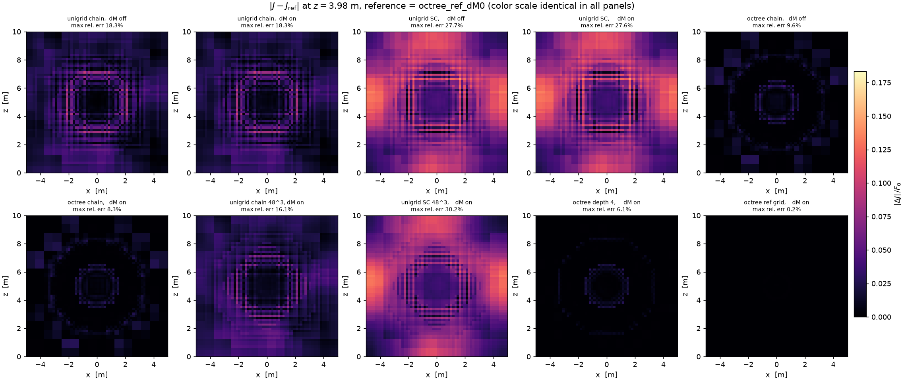
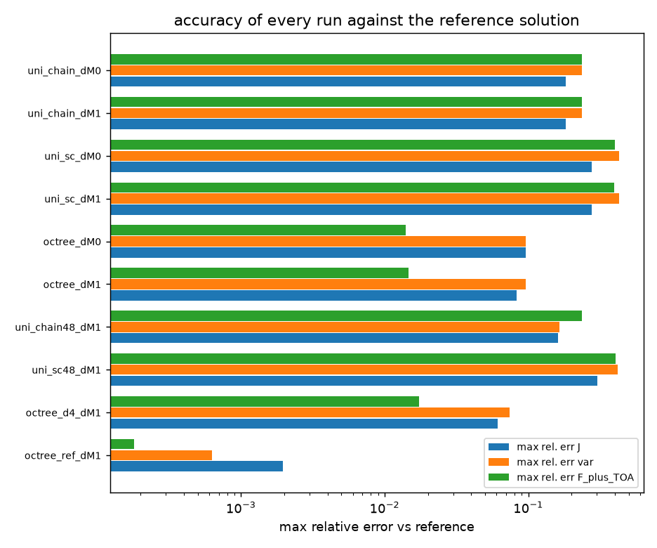
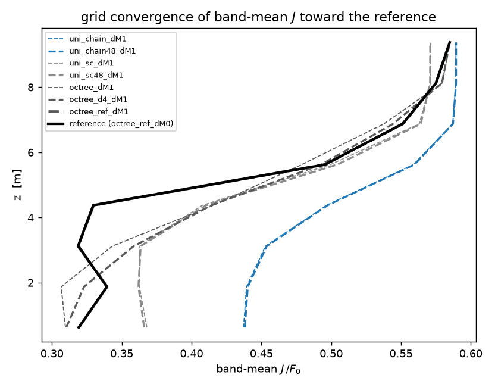
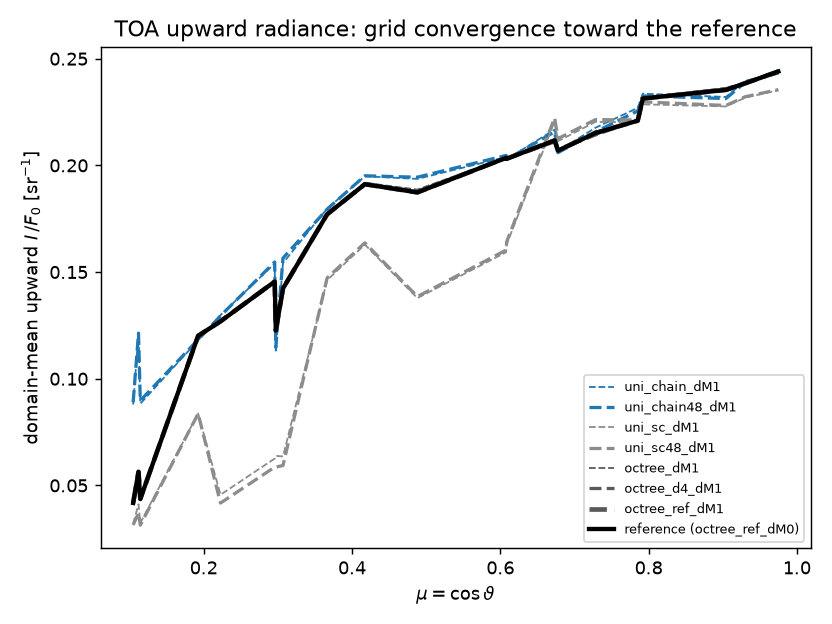

# Transport-scheme comparison — chain vs. SC vs. octree, with and without delta-M, ranked against a fine reference

Comparison of the three transport configurations of the `rt3d` solver on the
MANUAL §11 worked example, each run with and without delta-M (Wiscombe)
scaling, **plus a fine-octree reference solution and grid-refinement runs
that rank every configuration by accuracy** (plan:
`plan/compare-transport-plan.md` + `plan/transport-ranking-plan.md`); all
figures and CSVs live in `plot/compare_transport/`. Measured 2026-10-14 on
Windows with the `pyarts` interpreter; physics numbers are
machine-independent, wall times are not (the previous version of this report
was measured on macOS/arm64 — wall times differ by ~2–4× between the two
machines; Ng-accelerated iteration counts can also shift by a few iterations
with BLAS rounding, e.g. SC δ-off: 51 → 44).

Reproduce with:

```powershell
$env:Path = "$env:USERPROFILE\miniforge3\envs\pyarts\Library\bin;" + $env:Path
& "$env:USERPROFILE\miniforge3\envs\pyarts\python.exe" scripts/compare_transport.py
```

(3D HTML scenes need `trame-pyvista`; installed in the Windows `pyarts` env
on 2026-10-14, so all scenes and `vol_j.png` are current. Per-run solutions
are cached in `plot/compare_transport/_solve_cache/` (gitignored) — reruns
skip the solves.)

---

## 1. Purpose and run matrix

The solver currently offers three transport algorithms and an optional
delta-M split of the scattering operator. This study answers four questions
on one physically non-trivial case (strongly forward-scattering cloud,
solar beam, reflecting ground):

1. **chain vs. SC** — how large is the pure *transport-algorithm* error when
   both run on *identical cells*?
2. **unigrid vs. octree** — the grid-refinement error (validation anchor 5).
3. **delta-M on/off** — does it accelerate convergence, and does the
   converged solution stay the same (the equivalence claim of
   `plan/delta-m-plan.md`)?
4. **which run is best?** — pairwise differences alone cannot answer this
   (a gap between two approximations says nothing about which is closer to
   the exact solution), so the study adds a fine reference solution and
   ranks every run by its error against it (section 5).

Six comparison runs plus five ranking runs:

| run key | grid | transport | delta-M | role |
|---|---|---|---|---|
| `uni_chain_dM0` | unigrid 24³ | lattice-stencil chains | off | comparison |
| `uni_chain_dM1` | unigrid 24³ | lattice-stencil chains | M = 1 | comparison |
| `uni_sc_dM0`    | unigrid 24³ | single-cell short characteristics | off | comparison |
| `uni_sc_dM1`    | unigrid 24³ | single-cell short characteristics | M = 1 | comparison |
| `octree_dM0`    | octree (25 264 leaves) | exact characteristic marches | off | comparison |
| `octree_dM1`    | octree (25 264 leaves) | exact characteristic marches | M = 1 | comparison |
| `uni_chain48_dM1` | unigrid 48³ (h = 0.208 m) | chains | M = 1 | chain refinement |
| `uni_sc48_dM1`    | unigrid 48³ | short characteristics | M = 1 | SC refinement |
| `octree_d4_dM1`   | octree τ_max = 1.0, depth 4 (34 476 leaves) | exact marches | M = 1 | octree refinement |
| `octree_ref_dM1`  | octree τ_max = 0.5, depth 5 (50 380 leaves) | exact marches | M = 1 | fine-grid δ-M check |
| `octree_ref_dM0`  | same octree as `octree_ref_dM1` | exact marches | off | **the reference** |

---

## 2. The setups

### 2.1 Common physical case (MANUAL §11, unchanged)

Gaussian cloud + Lambertian ground + solar beam on the domain
x, y ∈ [−5, 5], z ∈ [0, 10] m, periodic in x and y, space at the top,
ground at the bottom. Units: lengths m, κ in m⁻¹, radiometric quantities
normalised to the incident beam flux F₀ = 1.

- **Extinction** κ_e = C·gauss(σ = 1 m, μ = (0, 0, 4) m), C scaled so the
  maximum vertical column optical depth is τ = 10 (peak κ_e ≈ 3.9 m⁻¹,
  mean free path ≈ 0.26 m).
- **Scattering** κ_s = ω_local·κ_e with ω_local = gauss/max(gauss), capped
  at ω ≤ 0.9 (`omega_cap=0.9`) so plain lambda iteration stays tractable.
- **Asymmetry** g_local = gauss/(1.05·max) → peak g ≈ 0.952 in the cloud
  core (HG phase function) — the showcase regime for delta-M.
- **Thermal emission** B = 0 (pure scattering/beam problem).
- **Solar beam**: direct collimated beam, 30° from zenith, propagating in
  the x–z plane: ω_sun = [sin 30°, 0, −cos 30°], F₀ = 1.
- **Boundary conditions**: isotropic background I = 1 on the top face;
  Lambertian ground, albedo 0.3, emissivity 0 (no thermal emission).

### 2.2 Direction grid and iteration scheme (identical in all runs)

- Icosahedral direction grid, refinement 1 → **42 ordinates** (development
  grid), solid-angle weights from spherical-triangle areas,
  Σw = 4π (−1.8e−15).
- Lambda iteration with **1D Ng acceleration**, convergence on the relative
  source change, tol = 1e−6, cap 60 iterations.
- The 42-ordinate *angular* error is identical in every run (including the
  reference) and therefore cancels in all comparisons; quantifying it is
  the phase-6 direction-convergence study.

### 2.3 Grids

- **Unigrid 24³**: h = 0.4167 m, 13 824 cells; **unigrid 48³**: h = 0.2083 m,
  110 592 cells.
- **Octree** base cell h₀ = 1.25 m, refinement driven by the *physical* κ_e,
  2:1 balanced:
  - depth 3 (τ_max = 2.0): **25 264 leaves** (L0: 316, L1: 788, L2: 3 680,
    L3: 20 480), cell size 1.25 m in the vacuum tails down to 0.156 m;
  - depth 4 (τ_max = 1.0): **34 476 leaves** (finest cells still 0.156 m —
    the extra refinement acts on the intermediate levels);
  - depth 5 (τ_max = 0.5): **50 380 leaves**, finest cells **0.078 m**
    (τ_cell ≤ 0.5 in the cloud core). κ_e-driven refinement *saturates*
    here: τ_max < 0.5 or depth > 5 adds no leaves, so this is the finest
    discretization the solver builds on this case — hence the reference.

### 2.4 Transport algorithms

- **`chain` (unigrid)** — lattice-stencil chain sweeps
  (`rt3d/characteristics.py`, DOIT-style): per ordinate one integer stencil
  s, characteristics run center-to-center across the whole grid in
  multi-cell chains. Exact for piecewise-constant sources along the chain;
  carries the known *grazing-ordinate stencil error* on coarse grids
  (MANUAL §6, anchor 5).
- **`sc` (unigrid)** — single-cell short characteristics
  (`rt3d/short_characteristics.py`, `plan/plan-sc-unigrid.md`):
  gap segment + target segment of equal length, bilinear 4-point face
  interpolation, wrap-around passes on periodic entry axes. Local and
  gather-only; more diffusive on coarse grids (path error ~ linear in cell
  size).
- **Octree** — exact characteristic marches
  (`transport.precompute_octree_march` + `sweep_direction_octree_exact`):
  one backward ray march per leaf per ordinate along the *true* ordinate
  direction, no lattice-stencil approximation. Short characteristics are
  *not available* on the octree (the solver raises `ValueError` for
  `transport="sc"` there).

### 2.5 delta-M scaling (`delta_M=1`, delta-Eddington)

Wiscombe split of the HG phase function, defined on the *row-normalized*
discrete operator (MANUAL §9, `plan/delta-m-plan.md`):

```
Phi_delta = Phi_HG - (1/4pi) * sum_{n<1} (2n+1) g^n P_n(Omega.Omega')
kappa_e_delta = kappa_e - kappa_s * g^M        (diffuse transport only)
```

with the explicit `-omega·g^M·I/(1 - omega·g^M)` term in the source. Only
the scattering part of the extinction is scaled; the direct beam keeps its
physical attenuation, and octree refinement stays driven by the physical
κ_e. delta-M changes the *iteration* (fewer iterations at g ≈ 0.95), not
the converged discrete solution — the on/off comparison below verifies
this.

### 2.6 The reference solution

`octree_ref_dM0`: the depth-5 octree (h_min = 0.078 m ≈ 3.3 cells per mean
free path in the cloud core), exact marches, **delta-M off** so it carries
no O(τ_cell) quadrature gap of the explicit −ω g^M I term. It is the finest
discretization available on this case; its own remaining error is bounded
by the depth-3 → depth-4 → depth-5 convergence sequence (section 5.2,
error roughly halving per level) and by the fine-grid δ-on↔δ-off check
(0.19% max, section 4.1).

---

## 3. Diagnostics

All cell fields are sampled onto one **common 64³ lattice** at the baseline
octree cell size (h = 0.15625 m) — exact pointwise sampling for
piecewise-constant fields, the finer reference cells are sampled, not
averaged — so every pair of runs is directly pointwise comparable.

- **Mean intensity** J = (1/4π)∫I dΩ.
- **Angular variance** σ²(r) = (1/4π)∫(I − J)² dΩ
  (`rt3d.diagnostics.angular_variance`) — zero for an isotropic field,
  measures the angular anisotropy of the radiation field.
- **Upward radiance at TOA**: the upward flux map
  F⁺(x, y) = ∫_{μ>0} I μ dΩ at the top layer, and the domain-mean upward
  radiance per upward ordinate (21 of the 42 ordinates have μ > 0).

Six comparison pairs (B − A): SC↔chain per δ, δ-on↔δ-off per method,
octree↔unigrid-chain per δ. Plus the **accuracy ranking**: every run
against `octree_ref_dM0` (`ranking.csv`).

---

## 4. Results

### 4.1 Convergence and efficiency

| run | transport | δ-M | n_iter | converged | wall [s] | ⟨J⟩ | mean F_z @TOA |
|---|---|---|---|---|---|---|---|
| `uni_chain_dM0` | chain | off | 32 | ✓ | 3.4 | 0.5188 | −2.5215 |
| `uni_chain_dM1` | chain | M=1 | **12** | ✓ | 1.5 | 0.5188 | −2.5214 |
| `uni_sc_dM0`    | sc    | off | 44 | ✓ | 24.7 | 0.4632 | −2.5935 |
| `uni_sc_dM1`    | sc    | M=1 | **12** | ✓ | 7.0 | 0.4633 | −2.5933 |
| `octree_dM0`    | octree march | off | 30 | ✓ | 95.3 | 0.4014 | −2.5312 |
| `octree_dM1`    | octree march | M=1 | **12** | ✓ | 47.5 | 0.4016 | −2.5308 |
| `uni_chain48_dM1` | chain 48³ | M=1 | 13 | ✓ | 19.5 | 0.5194 | −2.5223 |
| `uni_sc48_dM1`    | sc 48³    | M=1 | 12 | ✓ | 32.4 | 0.4640 | −2.5927 |
| `octree_d4_dM1`   | octree march d4 | M=1 | 12 | ✓ | 74.5 | 0.4114 | −2.5319 |
| `octree_ref_dM1`  | octree march d5 | M=1 | 12 | ✓ | 132.3 | 0.3841 | −2.5319 |
| `octree_ref_dM0`  | octree march d5 | off | 27 | ✓ | 231.6 | 0.3840 | −2.5320 |

- **delta-M is a large accelerator in this regime**: 32 → 12 (chain),
  44 → 12 (SC), 30 → 12 (octree d3), 27 → 12 (reference grid) iterations;
  wall time drops by ~2× everywhere and by 3.5× for SC.
- The unigrid TOA mean F_z reproduces the MANUAL §11 numbers exactly
  (−2.5215 unigrid, −2.5312 octree d3).
- **δ-M equivalence at the finest grid**: `octree_ref_dM1` vs
  `octree_ref_dM0` differ by 0.19% max / 0.01% mean in J — half the
  depth-3 gap (1.3%), confirming the O(τ_cell) scaling of the explicit
  term and that the reference is δ-M-independent.

### 4.2 Mean intensity J


Band-mean J profiles (8 base-cell bands, `profiles.csv`; δ-on/off pairs
agree to ≤3e−4, δ-off values shown):

| z [m] | chain 24³ | SC 24³ | octree d3 | chain 48³ | SC 48³ | octree d4 | reference |
|---|---|---|---|---|---|---|---|
| 0.625 | 0.4372 | 0.3680 | 0.3095 | 0.4382 | 0.3660 | 0.3102 | 0.3192 |
| 3.125 | 0.4529 | 0.3629 | 0.3431 | 0.4539 | 0.3636 | 0.3587 | 0.3187 |
| 4.375 | 0.4964 | 0.4077 | 0.4154 | 0.4974 | 0.4105 | 0.4143 | 0.3296 |
| 6.875 | 0.5870 | 0.5631 | 0.5377 | 0.5872 | 0.5642 | 0.5443 | 0.5512 |
| 9.375 | 0.5893 | 0.5712 | 0.5850 | 0.5894 | 0.5709 | 0.5849 | 0.5849 |

Note the reference column: in the cloud core (z = 3.1–4.4 m) the reference
J is far *lower* (0.32–0.33) than every depth-3-or-coarser run
(0.41–0.50) — the coarse grids overestimate in-cloud radiation trapping;
only the depth-4/5 octree resolution comes close.


- **chain vs. SC on identical cells is the largest pairwise discrepancy of
  the six-run study** (max 31%, mean 9%): SC's extra numerical diffusion
  lets more radiation penetrate the optically thick core, where it is
  absorbed (ω = 0.9, τ = 10) — J is lower everywhere below and inside the
  cloud (0.368 vs 0.437 in the bottom band).
- **unigrid-chain vs. octree** (18% max, 2.8% mean) reproduces the
  anchor-5 pattern of the manual: the unigrid grazing-ordinate stencil
  error inflates J below the cloud (0.437 vs 0.310 in the bottom band,
  the manual's 29%), with a ring structure around the cloud in the
  difference maps.
- **delta-M pairs are flat** (≤1.3% max, ~0.01–0.02% mean): the converged
  solution is independent of δ-M, as designed; the residual pointwise gap
  is the documented O(τ_cell) quadrature error of the explicit
  −ω g^M I term.

### 4.3 Angular variance


σ² is high in the vacuum (collimated beam + background = strongly
anisotropic field) and collapses toward zero inside the cloud core where
multiple scattering isotropises the field — the "hole" in all six panels.
Scheme differences show up mostly in the *shadow region below the cloud*
and in the beam path: SC's diffusion smooths the beam shadow (47.8% max
variance difference vs. chain), while the octree resolves the shadow
boundary at 0.156 m. delta-M changes σ² by ≤0.3%.

### 4.4 Upward radiance at TOA


- The **chain** runs show a *bright* spot above the cloud (the scattering
  layer seen from above), the **SC** runs a deep *shadow* blob — the
  TOA-integrated signature of SC's extra diffusion (max F⁺ difference
  35%). The octree map is coarse by construction (top-layer cells are
  1.25–2.5 m, the cloud is far below and the refinement is κ_e-driven).
- Per-ordinate domain-mean radiance (`toa_mean_radiance.csv`): chain and
  octree agree closely at all μ; SC collapses at grazing ordinates
  (μ = 0.10: 0.032 vs 0.088 chain / 0.041 octree) — the SC wrap-ring /
  grazing-path error — and lies between chain and octree at μ ≳ 0.7.
- Domain-mean upward radiance: chain 0.179, octree 0.170, SC 0.142
  [F₀ sr⁻¹]; consistently, the TOA net flux is least upward-escaping for
  SC (mean F_z −2.5935 vs −2.5215/−2.5312).

### 4.5 Pair statistics (from `pair_stats.csv`)

Relative differences of B − A, normalised by max|A| of the reference run
(max over the common lattice / mean over the domain):

| pair | J max | J mean | σ² max | σ² mean | F⁺ max | F⁺ mean |
|---|---|---|---|---|---|---|
| SC − chain, δ off | 31.1% | 9.1% | 47.8% | 6.2% | 35.2% | 9.8% |
| SC − chain, δ on  | 31.1% | 9.1% | 47.8% | 6.2% | 35.2% | 9.8% |
| δ1 − δ0, unigrid chain | 0.9% | 0.01% | 0.2% | 0.02% | 0.1% | 0.02% |
| δ1 − δ0, unigrid SC    | 0.7% | 0.01% | 0.2% | 0.01% | 0.0% | 0.02% |
| δ1 − δ0, octree        | 1.3% | 0.02% | 0.3% | 0.04% | 0.1% | 0.05% |
| octree − unigrid chain, δ off | 18.2% | 2.8% | 23.6% | 3.2% | 23.0% | 7.6% |

---

## 5. Which run is best? — accuracy ranking vs. the reference

All pairwise numbers above compare approximations *to each other*. Ranking
needs a solution that is demonstrably closer to the continuum limit: the
fine-octree reference `octree_ref_dM0` (section 2.6). Errors below are
relative to max|·| of the reference field on the common lattice
(`ranking.csv`, `err_bars.png`, `j_err_maps.png`).

### 5.1 Ranking

| run | wall [s] | J err max | J err mean | σ² err max | F⁺ err max | ΔF_z @TOA |
|---|---|---|---|---|---|---|
| `octree_ref_dM1` | 132.3 | 0.2% | **0.005%** | 0.1% | 0.0% | +0.0001 |
| `octree_d4_dM1` | 74.5 | 6.1% | **0.22%** | 7.4% | 1.7% | +0.0001 |
| `octree_dM1` | 47.5 | 8.3% | **0.47%** | 9.6% | 1.5% | +0.0011 |
| `octree_dM0` | 95.3 | 9.6% | 0.47% | 9.6% | 1.4% | +0.0008 |
| `uni_chain48_dM1` | 19.5 | 16.1% | **2.7%** | 16.4% | 23.7% | +0.010 |
| `uni_chain_dM1` | 1.5 | 18.3% | **2.7%** | 23.5% | 23.5% | +0.010 |
| `uni_chain_dM0` | 3.4 | 18.3% | 2.7% | 23.6% | 23.6% | +0.010 |
| `uni_sc48_dM1` | 32.4 | 30.2% | **6.8%** | 41.9% | 40.6% | −0.061 |
| `uni_sc_dM1` | 7.0 | 27.6% | **6.9%** | 42.8% | 39.7% | −0.061 |
| `uni_sc_dM0` | 24.7 | 27.7% | 6.9% | 42.8% | 39.8% | −0.061 |

(reference `octree_ref_dM0` = 0 by construction; ΔF_z relative to −2.5320:
chain +0.4%, SC −2.4%, octree d3 +0.03%)




**Accuracy order: octree ≫ unigrid chain > unigrid SC.** The octree is
6–15× more accurate than chain and 15× more accurate than SC in domain-mean
J error; at TOA flux the gap is even larger (0.4% vs 24% chain, 2.4% vs
10% SC mean F⁺ error).

### 5.2 Convergence evidence (why the ranking is meaningful)




- **Octree** (exact marches, error = cell-size error): mean J error
  0.47% (d3) → 0.22% (d4) → reference (d5); max error 9.6% → 6.1% → 0.
  Roughly halving per refinement level — the octree sequence converges
  toward the reference.
- **Unigrid chain** 24³ → 48³ (8× cells): mean error 2.74% → 2.69%,
  max 18.3% → 16.1% — *barely moves*. The chain error is dominated by the
  **grazing-ordinate stencil direction error**: each ordinate is marched
  along the best *integer lattice direction*, an angular error that does
  not shrink when h shrinks at fixed 42 ordinates. It converges with
  N_dir (phase 6), not with h.
- **Unigrid SC** 24³ → 48³: mean 6.92% → 6.79%, max 27.7% → 30.2% — also
  dominated by the angular grazing-ordinate wrap-ring error (section 4.4),
  not by cell size.

So the unigrid↔reference gap is an *angular path* error of the unigrid
transport algorithms at the 42-ordinate development grid; the octree's
exact marches remove it, which is why the octree wins by so much and why
refining the unigrid alone does not close the gap. (This refines the
earlier statement in this report that both errors are "first-order-ish in
h": the *cell-size* part is, but on this grid the *stencil-direction*
part dominates and is h-independent.)

### 5.3 Verdict

- **Most accurate** (of the original six): `octree_dM1` — 0.47% mean J
  error, 1.5% max TOA flux error, 47.5 s. The fine reference grid with
  δ-M (`octree_ref_dM1`, 132 s) reproduces the δ-off reference to 0.005%
  mean and is the right choice when the answer itself is the goal.
- **Best accuracy per cost**: `octree_dM1` for physically trustworthy
  fields; `uni_chain_dM1` (1.5 s, 2.7% mean error) is the cheap workhorse
  when 3% is acceptable — but its error is angular and will not shrink
  with grid refinement at 42 ordinates.
- **delta-M on strictly dominates off** at every grid and scheme: same
  converged fields (≤1.3% max, ≤0.05% mean), 2–3.5× less wall time. At
  cloud-core g ≈ 0.95 it should be the default.
- **SC is dominated on both axes**: less accurate *and* more expensive
  than chain at identical grids (24³: 6.9% @ 7.0 s vs 2.7% @ 1.5 s).

---

## 6. Findings

1. **delta-M (M = 1) does exactly what it should**: it cuts the iteration
   count to 12 for every scheme (from 32/44/30/27), and the converged
   fields agree with the δ-off runs to ≤1.3% max / ≤0.05% mean — the
   residual is the known O(τ_cell) explicit-term quadrature gap (it
   halves to 0.19% at the finest grid), not a physics change. At the
   cloud-core g ≈ 0.95 it should be the default setting.
2. **Against the fine reference, the accuracy order is octree ≫ chain >
   SC** (mean J error 0.5% vs 2.7% vs 6.9%). The unigrid↔reference gap is
   dominated by the *angular* grazing-ordinate errors of both unigrid
   schemes and does not shrink from 24³ to 48³; the octree's exact
   marches remove it, and the octree error then converges normally with
   refinement (0.47% → 0.22% → 0).
3. **SC is systematically more diffusive**: lower J inside and below the
   cloud, deeper TOA shadow, collapsed grazing-ordinate radiance, and a
   ~2.4% too-small net upward flux at TOA. It is also ~5× slower per
   iteration than chain on the unigrid (wrap-around ring passes).
4. **The octree buys both resolution and path fidelity**: finer cells
   where κ_e demands them (0.078 m in the reference cloud core) *and*
   marching along the true ordinate directions; its exact-march transport
   removes the chain's grazing-ordinate stencil error, which is why
   unigrid-chain vs. octree is the manual's anchor-5 pattern.
5. **δ-M is scheme- and grid-agnostic**: the δ-on↔δ-off differences are
   ~2 orders of magnitude smaller than any scheme comparison, so the
   comparison is not confounded by the scattering-operator split.
6. **Open point for phase 6**: the ranking is made at fixed 42 ordinates;
   the common angular error of *all* runs (including the reference) is
   not captured here. The unigrid schemes' h-independent stencil/wrap
   errors are expected to shrink with N_dir — the direction-convergence
   study should re-run this ranking at refinement 2/3.

---

## 7. Interactive 3D scenes

Self-contained vtk.js HTML (open directly in a browser — orbit, actor
visibility toggling, colour maps; no server, no Python needed). One scene
per run (κ_e isosurfaces at 0.5/1/2/3 m⁻¹ + J and σ² cut planes at
x = 0, y = 0, z = 4) plus difference scenes (|ΔJ| isosurfaces + slices),
all regenerated 2026-10-14 on Windows:

```
plot/compare_transport/scene_uni_chain_dM0.html   scene_uni_chain_dM1.html
plot/compare_transport/scene_uni_sc_dM0.html      scene_uni_sc_dM1.html
plot/compare_transport/scene_octree_dM0.html      scene_octree_dM1.html
plot/compare_transport/scene_octree_ref_dM0.html
plot/compare_transport/scene_diff_chain_vs_sc_dM0.html
plot/compare_transport/scene_diff_uni_vs_octree_dM0.html
plot/compare_transport/scene_diff_ref_vs_chain24_dM0.html
plot/compare_transport/scene_diff_ref_vs_sc24_dM0.html
plot/compare_transport/scene_diff_ref_vs_octree3_dM0.html
```

The three `ref_vs_*` scenes are the ranking story made visible: where each
coarse run gets J wrong against the reference (chain: below/around the
cloud; SC: everywhere diffuse; octree d3: cloud core only).

(pyvista's vtk.js export cannot carry volume mappers, hence slices +
isosurfaces; the static volume overview is `vol_j.png`.)

## 8. Output files

| file | content |
|---|---|
| `summary.csv` | run table (grid, iterations, wall, ⟨J⟩, TOA F_z), all 11 runs |
| `ranking.csv` | per-run error vs the reference (J, σ², F⁺, scalars) |
| `profiles.csv` | band-mean J profiles, all 11 runs |
| `toa_mean_radiance.csv` | per-ordinate domain-mean upward radiance at TOA |
| `pair_stats.csv` | max/mean relative differences of all six pairs × J, σ², F⁺ |
| `j_slices.png`, `j_profiles.png`, `j_diff.png` | mean-intensity figures |
| `j_err_maps.png` | \|J − J_ref\| at the cloud plane, every run vs reference |
| `j_convergence.png` | band-mean J: refinement sequences + reference |
| `err_bars.png` | max relative error vs reference, all runs (log scale) |
| `var_slices.png`, `var_diff.png` | angular-variance figures |
| `toa_fup_maps.png`, `toa_fup_diff.png`, `toa_mu_spectra.png` | TOA radiance figures |
| `toa_convergence.png` | TOA μ-spectra: refinement sequences + reference |
| `vol_j.png` | static volume renderings, base six runs + reference |
| `scene_*.html` | interactive 3D scenes (gitignored, regenerate by rerunning) |
| `_solve_cache/` | per-run solved fields (gitignored; reruns resume) |
