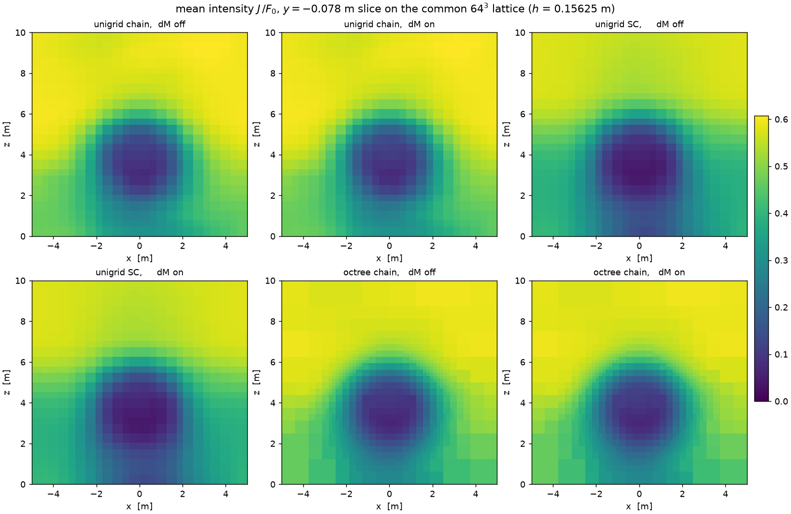
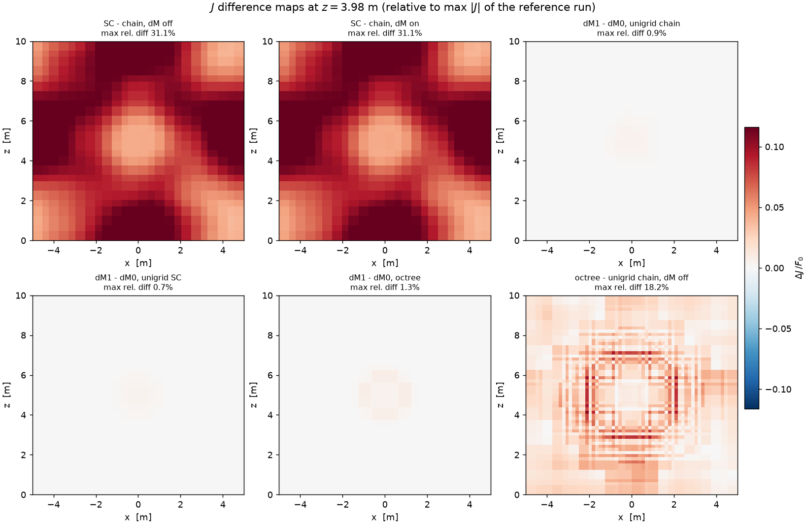
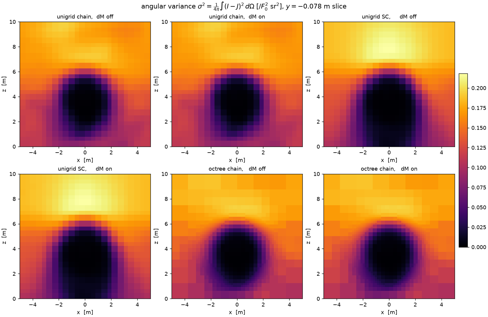
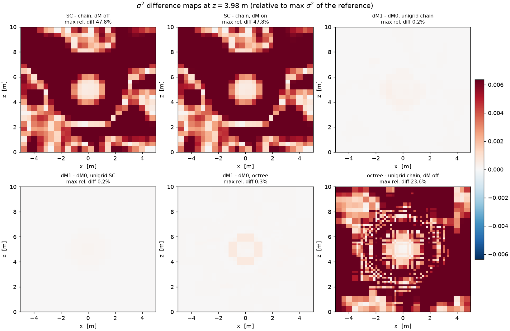
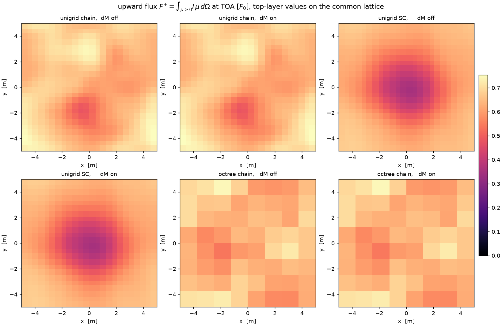
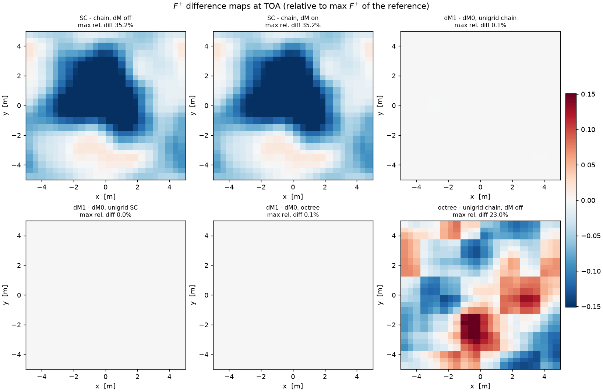
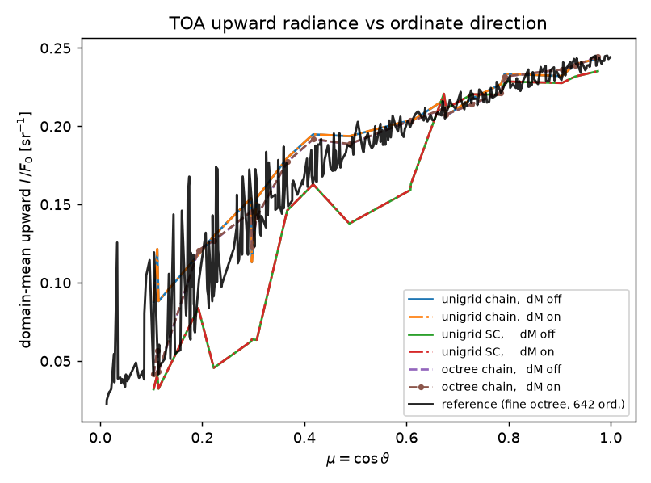

# Transport-scheme comparison — chain vs. SC vs. octree, with and without delta-M

Comparison of the three transport configurations of the `rt3d` solver on the
MANUAL §11 worked example, each run with and without delta-M (Wiscombe)
scaling. Generated by `scripts/compare_transport.py` (plan:
`plan/compare-transport-plan.md`); all figures and CSVs live in
`plot/compare_transport/`. Measured 2026-10-13 on macOS/arm64 with the
`pyarts` interpreter; iteration counts and physics numbers are
machine-independent, wall times are not.

Reproduce with:

```sh
~/miniforge3/envs/pyarts/bin/python scripts/compare_transport.py
```

(3D HTML scenes additionally need `trame-pyvista`, installed in `pyarts`.)

---

## 1. Purpose and run matrix

The solver currently offers three transport algorithms and an optional
delta-M split of the scattering operator. This study answers three questions
on one physically non-trivial case (strongly forward-scattering cloud,
solar beam, reflecting ground):

1. **chain vs. SC** — how large is the pure *transport-algorithm* error when
   both run on *identical cells*?
2. **unigrid vs. octree** — the grid-refinement error (validation anchor 5).
3. **delta-M on/off** — does it accelerate convergence, and does the
   converged solution stay the same (the equivalence claim of
   `plan/delta-m-plan.md`)?

Six runs, one per row:

| run key | grid | transport | delta-M |
|---|---|---|---|
| `uni_chain_dM0` | unigrid 24³ | lattice-stencil chains | off |
| `uni_chain_dM1` | unigrid 24³ | lattice-stencil chains | M = 1 |
| `uni_sc_dM0`    | unigrid 24³ | single-cell short characteristics | off |
| `uni_sc_dM1`    | unigrid 24³ | single-cell short characteristics | M = 1 |
| `octree_dM0`    | octree (25 264 leaves) | exact characteristic marches | off |
| `octree_dM1`    | octree (25 264 leaves) | exact characteristic marches | M = 1 |

---

## 2. The setups

### 2.1 Common physical case (MANUAL §11, unchanged)

Gaussian cloud + Lambertian ground + solar beam on the domain
x, y ∈ [−5, 5], z ∈ [0, 10] m, periodic in x and y, space at the top,
ground at the bottom. Units: lengths m, κ in m⁻¹, radiometric quantities
normalised to the incident beam flux F₀ = 1.

- **Extinction** κ_e = C·gauss(σ = 1 m, μ = (0, 0, 4) m), C scaled so the
  maximum vertical column optical depth is τ = 10 (peak κ_e ≈ 3.9 m⁻¹,
  mean free path ≈ 0.26 m).
- **Scattering** κ_s = ω_local·κ_e with ω_local = gauss/max(gauss), capped
  at ω ≤ 0.9 (`omega_cap=0.9`) so plain lambda iteration stays tractable.
- **Asymmetry** g_local = gauss/(1.05·max) → peak g ≈ 0.952 in the cloud
  core (HG phase function) — the showcase regime for delta-M.
- **Thermal emission** B = 0 (pure scattering/beam problem).
- **Solar beam**: direct collimated beam, 30° from zenith, propagating in
  the x–z plane: ω_sun = [sin 30°, 0, −cos 30°], F₀ = 1.
- **Boundary conditions**: isotropic background I = 1 on the top face;
  Lambertian ground, albedo 0.3, emissivity 0 (no thermal emission).

### 2.2 Direction grid and iteration scheme (identical in all six runs)

- Icosahedral direction grid, refinement 1 → **42 ordinates** (development
  grid), solid-angle weights from spherical-triangle areas,
  Σw = 4π (−7.1e−15).
- Lambda iteration with **1D Ng acceleration**, convergence on the relative
  source change, tol = 1e−6, cap 60 iterations.

### 2.3 Grids

- **Unigrid**: 24³ cells, h = 0.4167 m, 13 824 cells.
- **Octree**: base cell h₀ = 1.25 m; refinement driven by the *physical*
  κ_e (τ_max = 2.0 per cell, ε_grad = 1.0, max depth 3), 2:1 balanced;
  **25 264 leaves** (L0: 316, L1: 788, L2: 3 680, L3: 20 480), cell size
  1.25 m in the vacuum tails down to 0.156 m inside the cloud.

### 2.4 Transport algorithms

- **`chain` (unigrid)** — lattice-stencil chain sweeps
  (`rt3d/characteristics.py`, DOIT-style): per ordinate one integer stencil
  s, characteristics run center-to-center across the whole grid in
  multi-cell chains. Exact for piecewise-constant sources along the chain;
  carries the known *grazing-ordinate stencil error* on coarse grids
  (MANUAL §6, anchor 5).
- **`sc` (unigrid)** — single-cell short characteristics
  (`rt3d/short_characteristics.py`, `plan/plan-sc-unigrid.md`):
  gap segment + target segment of equal length, bilinear 4-point face
  interpolation, wrap-around passes on periodic entry axes. Local and
  gather-only; more diffusive on coarse grids (path error ~ linear in cell
  size).
- **Octree** — exact characteristic marches
  (`transport.precompute_octree_march` + `sweep_direction_octree_exact`):
  one backward ray march per leaf per ordinate, no lattice-stencil
  approximation. Short characteristics are *not available* on the octree
  (the solver raises `ValueError` for `transport="sc"` there).

### 2.5 delta-M scaling (`delta_M=1`, delta-Eddington)

Wiscombe split of the HG phase function, defined on the *row-normalized*
discrete operator (MANUAL §9, `plan/delta-m-plan.md`):

```
Phi_delta = Phi_HG - (1/4pi) * sum_{n<1} (2n+1) g^n P_n(Omega.Omega')
kappa_e_delta = kappa_e - kappa_s * g^M        (diffuse transport only)
```

with the explicit `-omega·g^M·I/(1 - omega·g^M)` term in the source. Only
the scattering part of the extinction is scaled; the direct beam keeps its
physical attenuation, and octree refinement stays driven by the physical
κ_e. delta-M changes the *iteration* (fewer iterations at g ≈ 0.95), not
the converged discrete solution — the on/off comparison below verifies
this.

---

## 3. Diagnostics

All cell fields are sampled onto one **common 64³ lattice** at the finest
octree cell (h = 0.15625 m) — exact for piecewise-constant fields — so
every pair of runs is directly pointwise comparable.

- **Mean intensity** J = (1/4π)∫I dΩ.
- **Angular variance** σ²(r) = (1/4π)∫(I − J)² dΩ
  (`rt3d.diagnostics.angular_variance`) — zero for an isotropic field,
  measures the angular anisotropy of the radiation field.
- **Upward radiance at TOA**: the upward flux map
  F⁺(x, y) = ∫_{μ>0} I μ dΩ at the top layer, and the domain-mean upward
  radiance per upward ordinate (21 of the 42 ordinates have μ > 0).

Six comparison pairs (B − A): SC↔chain per δ, δ-on↔δ-off per method,
octree↔unigrid-chain per δ.

---

## 4. Results

### 4.1 Convergence and efficiency

| run | transport | δ-M | n_iter | converged | wall [s] | ⟨J⟩ | mean F_z @TOA |
|---|---|---|---|---|---|---|---|
| `uni_chain_dM0` | chain | off | 32 | ✓ | 1.7 | 0.5188 | −2.5215 |
| `uni_chain_dM1` | chain | M=1 | **12** | ✓ | 0.8 | 0.5188 | −2.5214 |
| `uni_sc_dM0`    | sc    | off | 51 | ✓ | 18.0 | 0.4632 | −2.5935 |
| `uni_sc_dM1`    | sc    | M=1 | **12** | ✓ | 4.4 | 0.4633 | −2.5933 |
| `octree_dM0`    | octree march | off | 30 | ✓ | 42.9 | 0.4014 | −2.5312 |
| `octree_dM1`    | octree march | M=1 | **12** | ✓ | 23.9 | 0.4016 | −2.5308 |

- **delta-M is a large accelerator in this regime**: 32 → 12 (chain),
  51 → 12 (SC), 30 → 12 (octree) iterations; wall time drops by ~2×
  everywhere and by 4× for SC.
- The unigrid TOA mean F_z reproduces the MANUAL §11 numbers exactly
  (−2.5215 unigrid, −2.5312 octree).
- SC needs notably more iterations than chain *without* delta-M (51 vs 32)
  and is ~10× slower per iteration on this grid; with delta-M all three
  schemes converge in 12 iterations.

### 4.2 Mean intensity J



Band-mean J profiles (8 base-cell bands, `profiles.csv`):

| z [m] | chain δ-off | chain δ-on | SC δ-off | SC δ-on | octree δ-off | octree δ-on |
|---|---|---|---|---|---|---|
| 0.625 | 0.4372 | 0.4372 | 0.3680 | 0.3680 | 0.3095 | 0.3097 |
| 3.125 | 0.4529 | 0.4530 | 0.3629 | 0.3630 | 0.3431 | 0.3434 |
| 4.375 | 0.4964 | 0.4966 | 0.4077 | 0.4078 | 0.4154 | 0.4156 |
| 6.875 | 0.5870 | 0.5870 | 0.5631 | 0.5631 | 0.5377 | 0.5377 |
| 9.375 | 0.5893 | 0.5893 | 0.5712 | 0.5712 | 0.5850 | 0.5851 |



- **chain vs. SC on identical cells is the largest discrepancy of the
  study** (max 31%, mean 9%): SC's extra numerical diffusion lets more
  radiation penetrate the optically thick core, where it is absorbed
  (ω = 0.9, τ = 10) — J is lower everywhere below and inside the cloud
  (0.368 vs 0.437 in the bottom band).
- **unigrid-chain vs. octree** (18% max, 2.8% mean) reproduces the
  anchor-5 pattern of the manual: the unigrid grazing-ordinate stencil
  error inflates J below the cloud (0.437 vs 0.310 in the bottom band,
  the manual's 29%), with a ring structure around the cloud in the
  difference maps.
- **delta-M pairs are flat** (≤1.3% max, ~0.01–0.02% mean): the converged
  solution is independent of δ-M, as designed; the residual pointwise gap
  is the documented O(τ_cell) quadrature error of the explicit
  −ω g^M I term.

### 4.3 Angular variance




σ² is high in the vacuum (collimated beam + background = strongly
anisotropic field) and collapses toward zero inside the cloud core where
multiple scattering isotropises the field — the "hole" in all six panels.
Scheme differences show up mostly in the *shadow region below the cloud*
and in the beam path: SC's diffusion smooths the beam shadow (47.8% max
variance difference vs. chain), while the octree resolves the shadow
boundary at 0.156 m. delta-M changes σ² by ≤0.3%.

### 4.4 Upward radiance at TOA





- The **chain** runs show a *bright* spot above the cloud (the scattering
  layer seen from above), the **SC** runs a deep *shadow* blob — the
  TOA-integrated signature of SC's extra diffusion (max F⁺ difference
  35%). The octree map is coarse by construction (top-layer cells are
  1.25–2.5 m, the cloud is far below and the refinement is κ_e-driven).
- Per-ordinate domain-mean radiance (`toa_mean_radiance.csv`): chain and
  octree agree closely at all μ; SC collapses at grazing ordinates
  (μ = 0.10: 0.032 vs 0.088 chain / 0.041 octree) — the SC wrap-ring /
  grazing-path error — and lies between chain and octree at μ ≳ 0.7.
- Domain-mean upward radiance: chain 0.179, octree 0.170, SC 0.142
  [F₀ sr⁻¹]; consistently, the TOA net flux is least upward-escaping for
  SC (mean F_z −2.5935 vs −2.5215/−2.5312).

### 4.5 Pair statistics (from `pair_stats.csv`)

Relative differences of B − A, normalised by max|A| of the reference run
(max over the common lattice / mean over the domain):

| pair | J max | J mean | σ² max | σ² mean | F⁺ max | F⁺ mean |
|---|---|---|---|---|---|---|
| SC − chain, δ off | 31.1% | 9.1% | 47.8% | 6.2% | 35.2% | 9.8% |
| SC − chain, δ on  | 31.1% | 9.1% | 47.8% | 6.2% | 35.2% | 9.8% |
| δ1 − δ0, unigrid chain | 0.9% | 0.01% | 0.2% | 0.02% | 0.1% | 0.02% |
| δ1 − δ0, unigrid SC    | 0.7% | 0.01% | 0.2% | 0.01% | 0.0% | 0.02% |
| δ1 − δ0, octree        | 1.3% | 0.02% | 0.3% | 0.04% | 0.1% | 0.05% |
| octree − unigrid chain, δ off | 18.2% | 2.8% | 23.6% | 3.2% | 23.0% | 7.6% |

---

## 5. Findings

1. **delta-M (M = 1) does exactly what it should**: it cuts the iteration
   count to 12 for every scheme (from 32/51/30), and the converged fields
   agree with the δ-off runs to ≤1.3% max / ≤0.05% mean — the residual is
   the known O(τ_cell) explicit-term quadrature gap, not a physics change.
   At the cloud-core g ≈ 0.95 it should be the default setting.
2. **The transport-algorithm error dominates everything else on this
   24³ grid.** chain vs. SC differ by up to 31% in J and 35% in the TOA
   radiance — larger than the unigrid-vs-octree refinement error (18%).
   Both errors are first-order-ish in h and angular (grazing ordinates);
   they are *discretization* differences, not physical ones.
3. **SC is systematically more diffusive**: lower J inside and below the
   cloud, deeper TOA shadow, collapsed grazing-ordinate radiance, and a
   ~3% smaller net upward flux at TOA. It is also ~10× slower per
   iteration on the unigrid (wrap-around ring passes).
4. **The octree mainly buys resolution where it matters** (cloud interior,
   shadow boundary at 0.156 m) at 1.8× the unigrid cell count; its
   exact-march transport removes the chain's grazing-ordinate stencil
   error, which is why unigrid-chain vs. octree is the manual's anchor-5
   pattern.
5. **δ-M is scheme- and grid-agnostic**: the δ-on↔δ-off differences are
   ~2 orders of magnitude smaller than any scheme comparison, so the
   six-run comparison is not confounded by the scattering-operator split.

---

## 6. Interactive 3D scenes

Self-contained vtk.js HTML (open directly in a browser — orbit, actor
visibility toggling, colour maps; no server, no Python needed). One scene
per run (κ_e isosurfaces at 0.5/1/2/3 m⁻¹ + J and σ² cut planes at
x = 0, y = 0, z = 4) plus two difference scenes (|ΔJ| isosurfaces +
slices):

```
plot/compare_transport/scene_uni_chain_dM0.html   scene_uni_chain_dM1.html
plot/compare_transport/scene_uni_sc_dM0.html      scene_uni_sc_dM1.html
plot/compare_transport/scene_octree_dM0.html      scene_octree_dM1.html
plot/compare_transport/scene_diff_chain_vs_sc_dM0.html
plot/compare_transport/scene_diff_uni_vs_octree_dM0.html
```

(pyvista's vtk.js export cannot carry volume mappers, hence slices +
isosurfaces; the static volume overview is `vol_j.png`.)

## 7. Output files

| file | content |
|---|---|
| `summary.csv` | run table (iterations, wall, ⟨J⟩, TOA F_z) |
| `profiles.csv` | band-mean J profiles, all six runs |
| `toa_mean_radiance.csv` | per-ordinate domain-mean upward radiance at TOA |
| `pair_stats.csv` | max/mean relative differences of all six pairs × J, σ², F⁺ |
| `j_slices.png`, `j_profiles.png`, `j_diff.png` | mean-intensity figures |
| `var_slices.png`, `var_diff.png` | angular-variance figures |
| `toa_fup_maps.png`, `toa_fup_diff.png`, `toa_mu_spectra.png` | TOA radiance figures |
| `vol_j.png` | static volume renderings, all six runs |
| `scene_*.html` | interactive 3D scenes (gitignored, regenerate by rerunning) |
