# Short-characteristics transport — unigrid and octree

Detailed reference for the transport sweeps in `rt3d`: how characteristics are
constructed on each spatial grid, how the formal solution is evaluated in a
fully vectorized way, and how the pieces fit into the lambda-iteration loop of
`rt3d.solver`.

Companion figures are generated by `scripts/sc_transport_figures.py` into
`plot/` (they use the real `rt3d` geometry helpers, so they show exactly what
the solver does).

Code under discussion:

| file | role |
|---|---|
| `rt3d/geometry.py` | cuboid domain, `unigrid`, `ray_box_exit`, `march_lattice` (DDA on the lattice) |
| `rt3d/octree.py` | `octree_grid`, `march_octree` (DDA on the octree), `node_major_segments` |
| `rt3d/characteristics.py` | `build_chain` (unigrid), `build_chain_octree` (reference), stencils, sub-segments |
| `rt3d/transport.py` | `boundary_conditions`, `sweep_direction`, `sweep_all`, `precompute_octree_march`, `sweep_direction_octree_exact`, beam optical depths |
| `rt3d/short_characteristics.py` | alternative unigrid transport: `sc_stencil`, `build_sc_chain`, `sweep_direction_sc`, `sweep_all_sc` (selected via `transport="sc"`, §12) |
| `rt3d/solver.py` | `lambda_iteration` — drives the sweeps |

---

## 1. Scope, notation, the formal solution

The solver is monochromatic, scalar, straight-ray (no refraction). For one
ordinate $\boldsymbol{\Omega}$ and one target cell $c$, the *characteristic*
is the straight line through $c$'s center pointing upwind along
$-\boldsymbol{\Omega}$. The intensity at the cell center is the formal
solution of the RTE along that line.

Along the characteristic the traversed cells are $c_1, c_2, \dots$ (in
propagation order) and the path is split into **sub-segments** — maximal
pieces inside one cell. With the source $S$ piecewise constant per cell, the
formal solution is **exact**:

$$
I_c \;=\; I_{\text{in}}\, e^{-\tau_{\text{tot}}}
\;+\; \sum_{\text{sub}} S_{\text{sub}}\,
       \underbrace{\left(1 - e^{-\tau_{\text{sub}}}\right)}_{\text{emit along sub}}\,
       \underbrace{e^{-\tau_{\text{after}}}}_{\text{absorb on the way to } c}
$$

where

* $\tau_{\text{sub}} = \kappa_e[\text{cell of sub}] \cdot \ell_{\text{sub}}$ —
  optical depth of the sub-segment itself,
* $\tau_{\text{after}}$ — optical depth of all path between that sub-segment
  and the target center,
* $\tau_{\text{tot}}$ — total optical depth of the whole characteristic,
* $I_{\text{in}}$ — inflow intensity at the domain entry point (§7).

Two conventions used consistently in the code:

* $1 - e^{-\tau}$ is computed as `-np.expm1(-tau)` (accurate for
  optically thin segments);
* segment blocks are stored either **center → entry** (root chains, exact
  octree marches) or **parent → target** (interior chains). The attenuation
  factor of a segment is then `exp(-prefix_before)` in the first ordering and
  `exp(-(tau_tot - prefix_through))` in the second — see §4.3 and the figure
  in §4.4.

---

## 2. Shared architecture of both grids

Both grids expose the same interface to the transport — cell/leaf centers,
domain box, O(1) point location — and both sweeps follow the same two-phase
pattern:

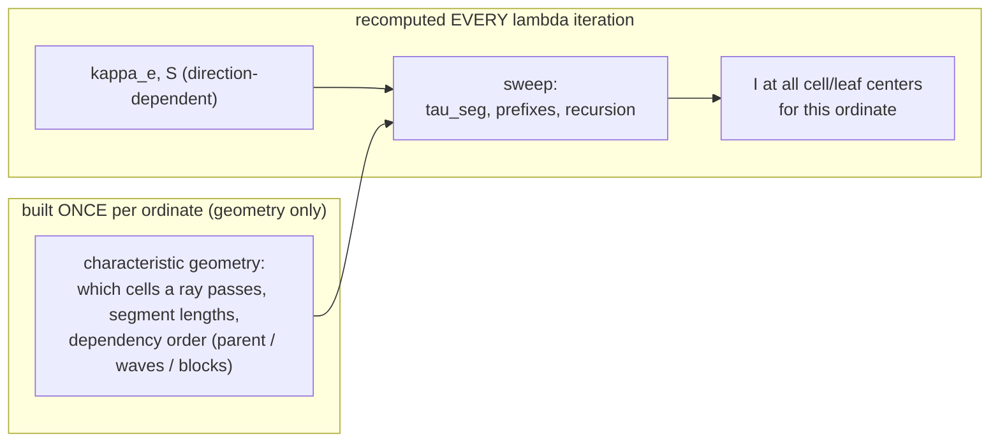

Because the characteristic geometry depends only on *grid + direction*, it is
built once per ordinate and reused across all iterations (`chains` /
`marches` arguments of `sweep_all*`, and `solver.lambda_iteration`). Only
$\kappa_e$ and $S$ change between iterations.

The dependency structure is a **forest**: every characteristic ends at a
domain entry face (the *root* chains) and every other cell's intensity is
computed from its upwind predecessor. The reason this never cycles is that
**every ordinate has $\Omega_z \neq 0$** (guaranteed by the direction-grid
rotation, plan §4) and $z$ is the only non-periodic dimension — along any
chain, $z$ moves monotonically toward an entry face.

---

## 3. Unigrid: lattice stencil chains

Files: `characteristics.build_chain` + `transport.sweep_direction`.

The key idea: on a uniform Cartesian lattice, *one integer stencil*
$s=(s_x,s_y,s_z)$ per ordinate describes the upwind connection of **every**
cell ($u = c - s$), and the sub-segment decomposition of the straight path
$u_{\text{center}} \to c_{\text{center}}$ is the *same relative offsets and
lengths for every cell*. The whole sweep becomes a handful of vectorized
gathers per topological wave.

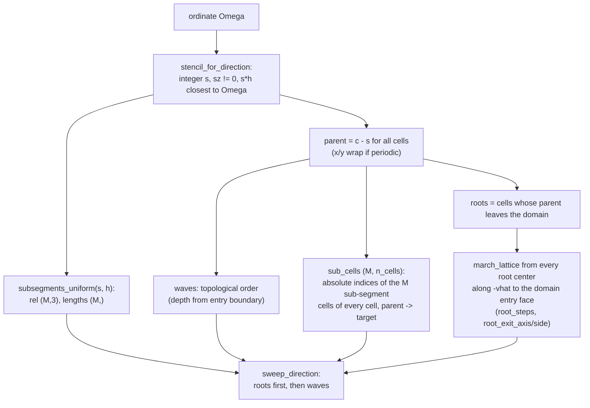

### 3.1 Stencil selection (`stencil_for_direction`)

The upwind cell of $c$ is $c - s$ where $s$ is the lattice offset whose
physical direction $s \cdot h$ is closest to $\boldsymbol{\Omega}$
(bipolar / Rybicki–Hummer connection, specialized to a lattice):

* constraints: $s \neq 0$, $s_z \neq 0$ (chains must terminate in $z$);
* objective: maximize $\cos\angle(s\cdot h, \Omega)$;
* tie-break: prefer the **shorter** stencil (better memory locality, smaller
  waves);
* search radius: automatic, $\;\text{radius} = \min\!\big(24,\ \max(3,\lceil 3\,\max(h)/\min(h)\rceil)\big)$.
  A direction with slope $dz/dx \approx 3$ on a lattice with $h_z = h_x/4$
  needs $s_z \approx 12$ — a fixed small radius leaves large,
  refinement-independent direction errors.

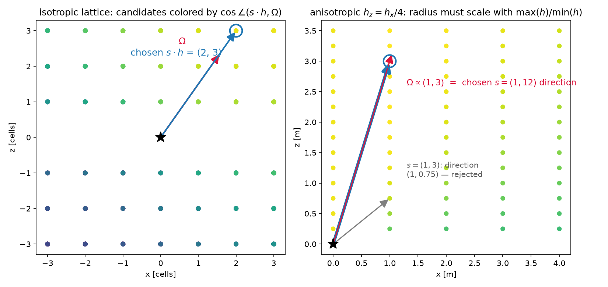

*Left: candidate offsets on an isotropic lattice, colored by alignment; the
chosen $s\cdot h$ (blue) approximates $\Omega$ (red). Right: on an
anisotropic lattice the naive short stencil $(1,3)$ points along
$(1, 0.75)$ — far off $\Omega \propto (1,3)$ — while the radius-scaled
search finds the exact $(1,12)$.*

The actual characteristic direction is $\hat v = s\cdot h / |s\cdot h|$;
the deviation $\angle(\hat v, \Omega)$ is the intrinsic **path error** of
short characteristics on a lattice and converges with grid refinement.

### 3.2 Sub-segment splitting (`subsegments_uniform`)

The straight path from $u_{\text{center}}$ to $c_{\text{center}}$ crosses
$M$ cells; each crossing point is a sub-segment boundary. The split is
computed in **lattice-normalized coordinates** $q = p/h$, where the path is
$-s \to 0$ along $s/|s|$ and cell faces sit at half-integers; physical
lengths are recovered by the scale $|s\cdot h| / |s|$.

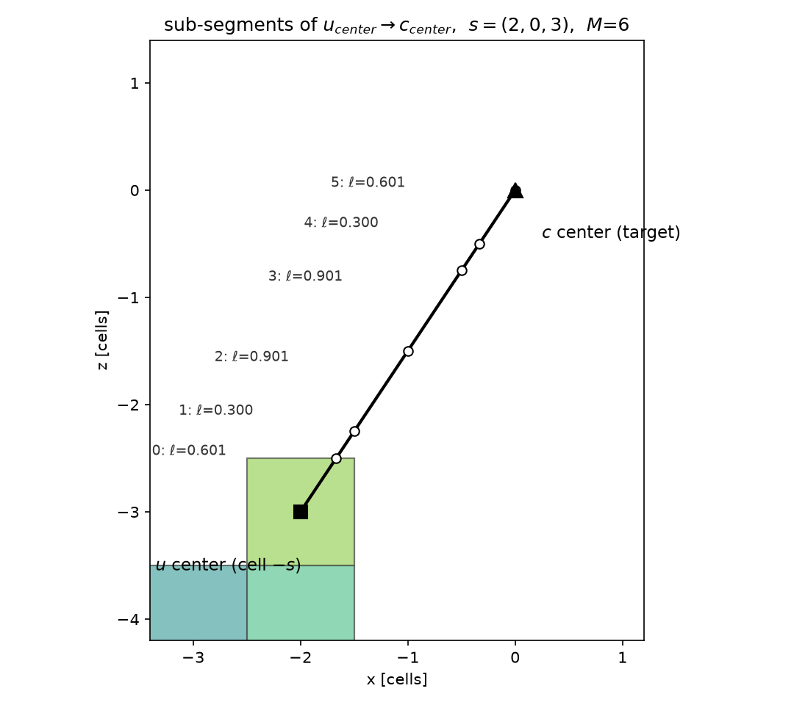

*Sub-segments of $u_{\text{center}}\to c_{\text{center}}$ for
$s=(2,0,3)$, $h=(1,1,1)$: $M=6$ segments with lengths 0.601, 0.300, 0.901,
0.901, 0.300, 0.601 — summing to $|s\cdot h| = \sqrt{13}$.*

Because the relative offsets `rel (M,3)` and `lengths (M,)` are identical
for every target cell, `build_chain` materializes them once as absolute
indices `sub_cells (M, n_cells)` — the sweep then just gathers
`sub_cells[m][wave]`.

### 3.3 Parent array, roots, topological waves

`parent[c] = c - s` (flat index), with $x/y$ wrapping when the sides are
periodic; cells whose parent leaves the domain are **roots**.

Waves are ordered by chain depth — the number of stencil hops from the entry
boundary — so that every cell appears strictly after its parent:

* **periodic x/y**: only $z$ decreases monotonically along a chain, so
  $\text{depth} = k$ if $s_z > 0$, else $n_z - 1 - k$;
* **non-periodic**: $\text{depth} = \min$ over the non-zero stencil axes of
  the distance to the upwind boundary along that axis.

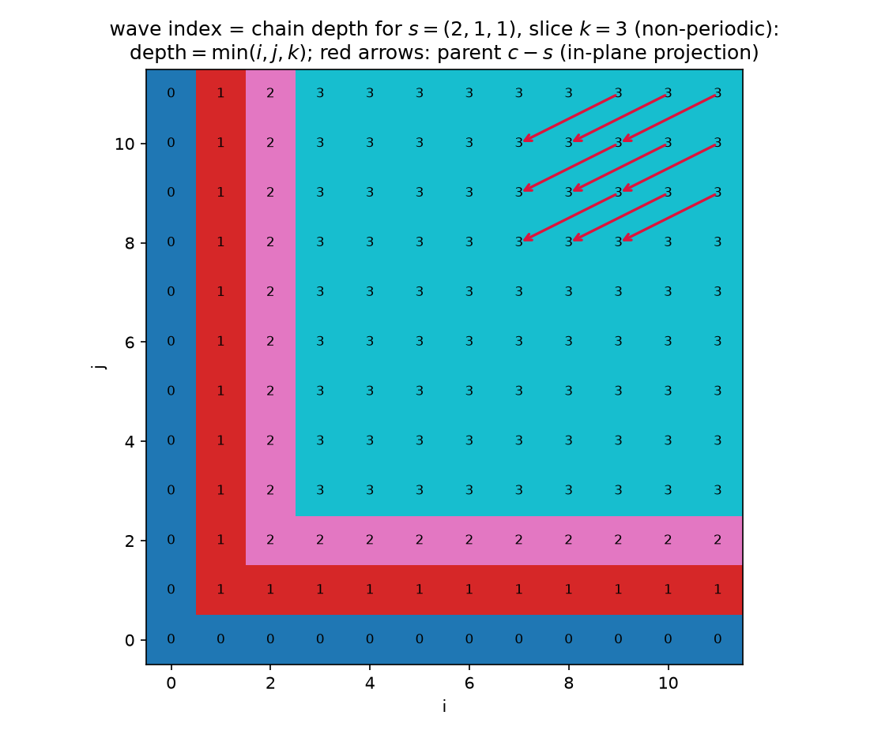

*Wave index (= chain depth) for $s=(2,1,1)$ on a $k=3$ slice; a cell in wave
$d$ reads its parent from wave $< d$, so each wave is one batch of gathers.*

### 3.4 Root chains: exact backward march to the entry face

A root's characteristic does not start at another cell — it starts at the
domain entry face. `march_lattice` (Amanatides–Woo DDA, vectorized over all
roots simultaneously, with periodic wrap bookkeeping) marches each root
center along $-\hat v$ and records the traversed cells and lengths
(`root_steps`, step-major, ordered **center → entry**), plus the exit face
(`root_exit_axis`, `root_exit_side`) that selects the inflow (§7).

### 3.5 The sweep (`sweep_direction`)

```python
# --- roots: segments ordered center -> entry.
# The attenuation of a segment to the root center is exp(-tau_acc),
# where tau_acc sums the segments already visited (they lie between
# this segment and the center).
tau_acc = 0; src_acc = 0
for (ridx, cell, ln) in root_steps:            # step-major over all roots
    tau = kappa_e[cell] * ln
    src_acc[ridx] += S[cell] * (-expm1(-tau)) * exp(-tau_acc[ridx])
    tau_acc[ridx] += tau
I[roots] = I_in * exp(-tau_acc) + src_acc      # I_in from bc / ground

# --- interior cells, one gather batch per wave
for wave in waves:
    tau_tot = sum_m kappa_e[sub_cells[m][wave]] * sub_len[m]
    contrib = sum_m S[sub_cells[m][wave]] * (-expm1(-tau_m))
                      * exp(-(tau_tot - prefix_through_m))
    I[wave] = I[parent[wave]] * exp(-tau_tot) + contrib
```

Note the two orderings: root segments run **center → entry** (attenuation
factor `exp(-prefix_before)`), interior sub-segments run **parent → target**
(attenuation factor `exp(-(tau_tot - prefix_through))`). Both evaluate the
same exact formal solution.

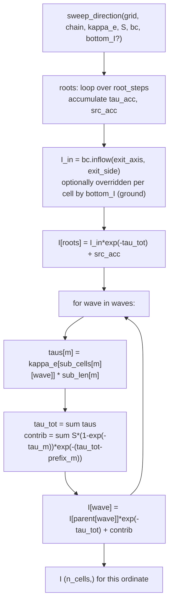

`sweep_all` loops over ordinates; $S$ may be `(n_cells,)` or
`(n_cells, N_dir)` — the latter is what anisotropic (HG) scattering requires.

---

## 4. Octree: exact characteristic marches

Files: `transport.precompute_octree_march` +
`transport.sweep_direction_octree_exact` (used by the solver), with
`octree.march_octree` as the DDA engine.

On the graded octree there is no single lattice stencil. The solver therefore
abandons the center-to-center chain here and marches the **true ray**
through the tree: one backward ray from every leaf center to the domain
entry point. The only remaining path error is then the octree's own field
resolution — there is no stencil direction error at all.

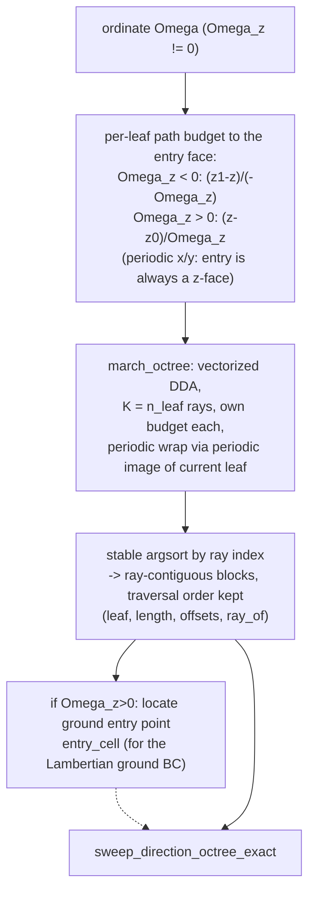

### 4.1 The DDA march (`march_octree`)

All $n_{\text{leaf}}$ rays advance in lockstep per traversal step
(step-major, like `march_lattice`): for each still-active ray, the distance
to the next face of its **current leaf** is
$(c_{\text{leaf}} \pm h_{\text{leaf}} - p)/d$ per axis, the minimum wins,
the segment `(ray, leaf, length)` is recorded, and the ray is re-`locate`d
(vectorized tree descent) after crossing. With periodic $x/y$ the face
distances use the periodic image of the current leaf closest to the ray
position. Each ray carries its own path-length **budget**, so a ray simply
stops at the domain entry point.

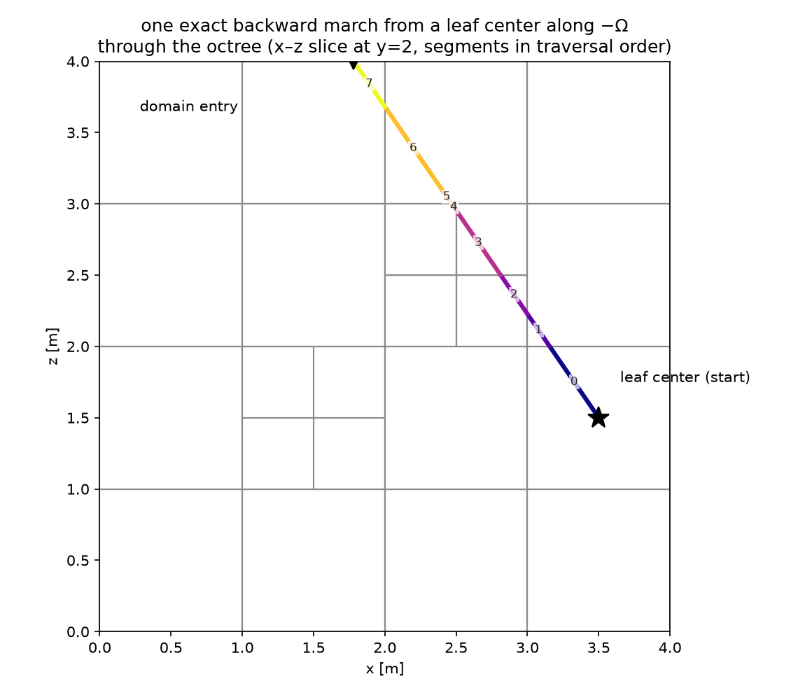

*One backward march from a leaf center along $-\Omega$ through a balanced
octree (x–z slice); segments are numbered in traversal order
(center → entry).*

### 4.2 Ray-contiguous block layout

`march_octree` returns step-major segments (`seg_ray` nondecreasing per
step). `precompute_octree_march` regroups them with a **stable** argsort by
ray index, which keeps the traversal order *within* each ray:

```
leaf    = [L01 L02 L03 L04 | L11 L12 | L21 L22 L23]   (segment's leaf)
length  = [ 0.7  1.3  0.4  0.9 | 1.1  0.6 | 0.5  1.4  0.8 ]
offsets = [0     4            6          9]            (block boundaries)
ray_of  = [ 0    0    0    0  | 1    1   | 2    2    2 ]
```

Segments of ray $r$ (whose target is leaf $r$) occupy
`[offsets[r], offsets[r+1])`, ordered **center → entry**.

### 4.3 Block prefixes with a single cumsum (`_block_prefixes`)

Per-segment optical depths $\tau_{\text{seg}} = \kappa_e[\text{leaf}]\cdot\ell$
are needed with *within-block* running sums. One global `np.cumsum` plus a
per-block offset correction gives both prefixes:

$$
C_m = \sum_{m' \le m} \tau_{\text{seg},m'}, \qquad
\text{prev}_r = C_{\text{offsets}[r]-1}, \qquad
\text{prefix}^{\text{before}}_m = C_m - \tau_{\text{seg},m} - \text{prev}_{r(m)}
$$

(`prefix_through` is $C_m - \text{prev}_{r(m)}$). The per-ray totals
$\tau_{\text{tot}}$ come from `np.add.at(tau_tot, ray_of, tau_seg)`.

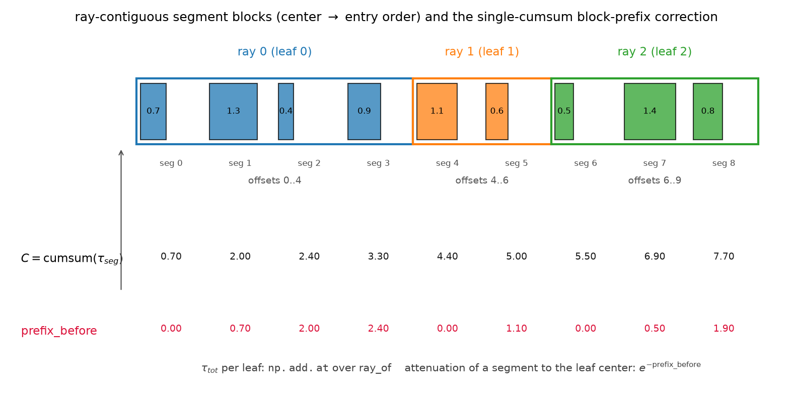

*Three rays, four/two/three segments each. The single cumsum row $C$ is
corrected by the value at the previous block end to give each segment's
optical depth to its own leaf center.*

### 4.4 The sweep (`sweep_direction_octree_exact`)

With segments ordered center → entry, the attenuation of a segment
contribution to the leaf center is `exp(-prefix_before)`, and **no
topological waves are needed at all** — each leaf's whole characteristic
(entry → center) is integrated in one shot, so the entire ordinate is one
fully vectorized expression:

```python
tau_seg    = kappa_e[leaf] * length
pre_before, _ = _block_prefixes(tau_seg, offsets)
tau_tot    = np.add.at over ray_of of tau_seg          # (n_leaf,)

I = np.add.at(S[leaf] * (-expm1(-tau_seg)) * exp(-pre_before))   # onto ray_of
I += I_in * exp(-tau_tot)          # or bottom_I[entry_cell] for upward rays
```

$I_{\text{in}}$ is `bc.top_I` for downward ordinates ($\Omega_z<0$, ray
enters through the top) and `bc.bottom_I` / ground radiance for upward ones.

### 4.5 Ground entry cells

For upward ordinates the backward ray ends at the **ground plane**, not at a
cell. `precompute_octree_march` additionally computes, per ray, the ground
entry point $p = c_{\text{leaf}} - \text{budget}\cdot\Omega$ (wrapped into
the periodic box, $z$ clamped to $z_0$) and its leaf via `oct.locate` —
`march["entry_cell"]`. The solver passes the Lambertian ground radiance
evaluated per column as `bottom_I=I_g[chain["entry_cell"]]` (§7.2).

---

## 5. The approximate octree chain (`build_chain_octree`) — reference

`characteristics.build_chain_octree` + `transport.sweep_direction_octree`
implement the *same* center-to-center (bipolar) connection as the unigrid,
generalized to the graded grid. It is kept as a reference implementation but
**the solver does not use it**: the center-to-center connection showed
non-converging path errors in heterogeneous 3D fields (the chosen
predecessor center-to-center line can deviate from $\Omega$ by an amount
that does not shrink with refinement on a graded grid). It is documented
here because it is exercised by `scripts/phase3_octree.py` and its
machinery (peeling, node-major segments) is instructive.

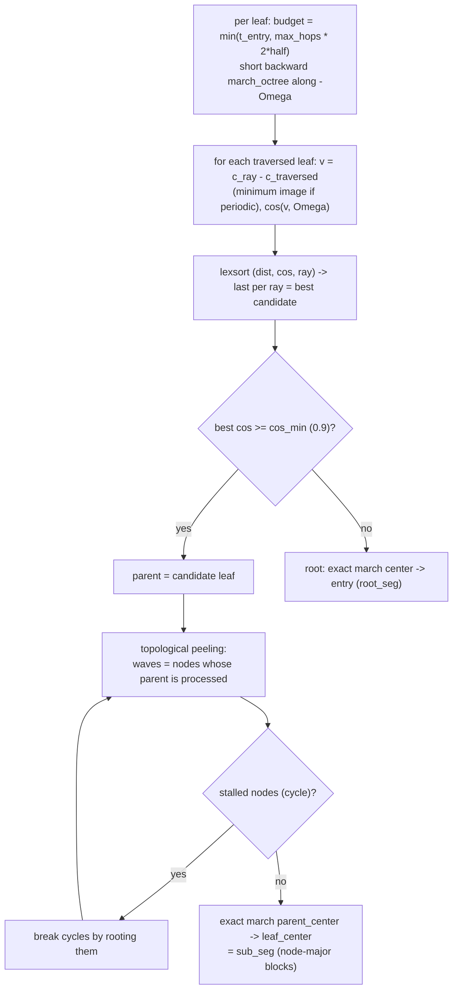

* `cos_min` / `max_hops` bound both the direction error and the search cost.
* **Cycles**: unlike the lattice case, center-to-center connections on a
  graded grid can form dependency cycles. They are detected by *topological
  peeling* — when no remaining node has a processed parent, the remaining
  set is a union of cycles and is rooted (each such leaf then carries an
  exact march to the boundary, which is always valid).
* The sweep is the octree analogue of §3.5: root blocks (center → entry)
  first, then BFS waves over `sub_seg` blocks (parent → target);
  `tau_tot`/`contrib` are computed once per sweep because they depend only
  on $\kappa_e$ and $S$, not on $I$.

---

## 6. Beam optical depth sweeps

The direct solar beam is not on the quadrature; its attenuation
$\tau_b$ at every cell/leaf center is computed with the *same* march
machinery, with the source term dropped (pure absorption along the backward
beam ray, physical $\kappa_e$ even under delta-M):

| grid | function | march | budget |
|---|---|---|---|
| unigrid | `transport.beam_optical_depth` | `march_lattice(centers, -omega_sun)` | to box exit |
| octree | `transport.beam_optical_depth_octree` | `march_octree(centers, -omega_sun)` | periodic: $(z_1-z)/|\Omega_{\odot,z}|$; else `ray_box_exit` |

`beam_irradiance_ground` extends $\tau_b$ from the bottom-cell centers to
the ground plane through the bottom cell itself:
$\tau_g = \tau_b + \kappa_e (z - z_0)/|\mu_{\odot}|$, giving
$F_0 |\mu_{\odot}| e^{-\tau_g}$ at the ground.

---

## 7. Boundary conditions inside the sweep

### 7.1 Face selection (`boundary_conditions.inflow`)

Each root chain knows the face its backward march exited through
(`root_exit_axis`, `root_exit_side`):

```
exit_axis == 2, side > 0  ->  top_I      (space)
exit_axis == 2, side < 0  ->  bottom_I   (or ground radiance, §7.2)
exit_axis in {0, 1}       ->  side_I     (ignored when x/y are periodic)
```

With periodic $x/y$ the exit is always a $z$-face, so the side faces never
appear.

### 7.2 Lambertian ground (phase 5)

The ground radiance couples downward and upward ordinates; the solver
therefore sweeps **downward ordinates first**, builds the ground radiance,
then sweeps upward ones:

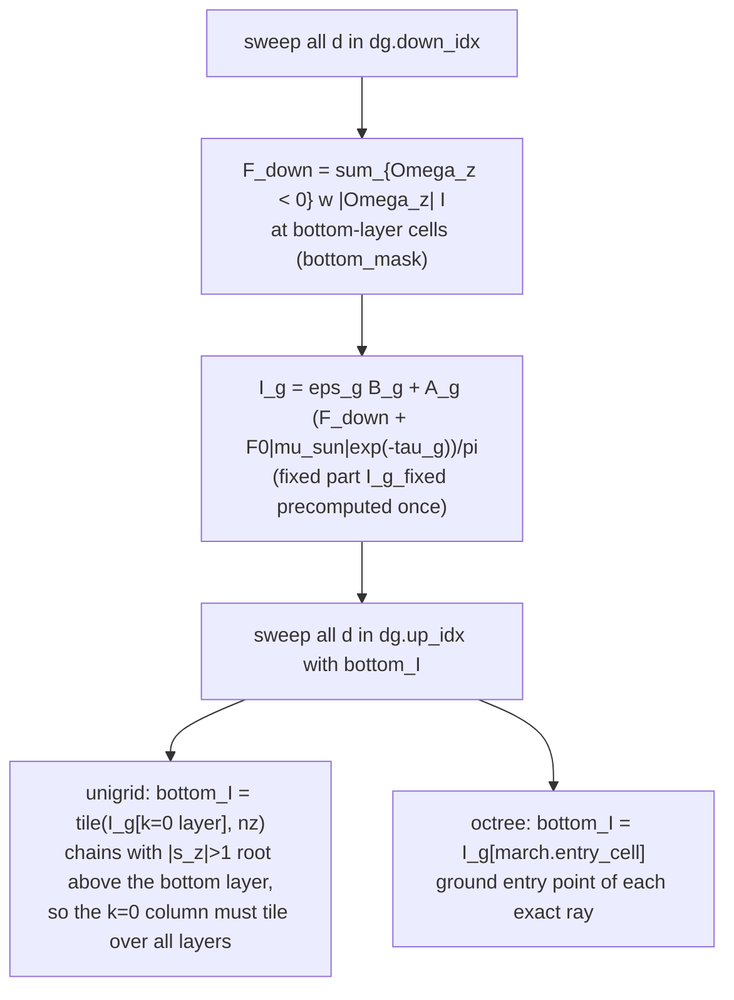

*Tiling note (unigrid):* a chain with $|s_z| > 1$ roots at layer
$|s_z|-1$, not at $k=0$; the ground radiance is a column field, so the
$k=0$ values are tiled over all layers and only bottom-entry roots read
them. *Octree:* no tiling needed — each ray knows its own ground entry
leaf via `entry_cell`.

---

## 8. Solver-level flowchart

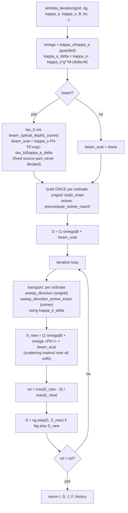

The ground branch of the loop (§7.2) replaces the single transport block
with the down-then-up ordering. Delta-M scales only the **diffuse**
transport ($\kappa_e^{(\delta)}$ in the sweeps); the beam and the ground
beam term keep the physical $\kappa_e$.

---

## 9. Data-structure reference

### `characteristics.build_chain` (unigrid) — one dict per ordinate

| key | shape / type | meaning |
|---|---|---|
| `s` | (3,) int | lattice stencil, $s_z \neq 0$ |
| `vhat` | (3,) float | characteristic unit direction $s\cdot h/|s\cdot h|$ |
| `parent` | (n_cells,) int | upwind cell $c-s$, `-1` for roots |
| `roots` | (R,) int | boundary-entry cells |
| `waves` | list of (n_w,) int | topological order; parent strictly earlier |
| `sub_cells` | (M, n_cells) int | sub-segment cells of every cell, parent → target |
| `sub_len` | (M,) float | sub-segment lengths (same for every cell) |
| `root_steps` | list of (ray, cell, len) | step-major DDA segments, root center → entry |
| `root_exit_axis/side` | (R,) int | entry face of each root chain |

### `transport.precompute_octree_march` — one dict per ordinate

| key | shape / type | meaning |
|---|---|---|
| `leaf` | (M,) int | leaf of each segment, ray-contiguous blocks |
| `length` | (M,) float | segment lengths |
| `offsets` | (n_leaf+1,) int | block boundaries; ray $r$ = `[offsets[r], offsets[r+1])` |
| `ray_of` | (M,) int | ray (= target leaf) index per segment |
| `omega` | (3,) float | ordinate direction |
| `entry_cell` | (n_leaf,) int or None | for $\Omega_z>0$: bottom-face leaf at the ray's ground entry |

### `characteristics.build_chain_octree` (reference) — one dict per ordinate

| key | shape / type | meaning |
|---|---|---|
| `parent` | (n_leaf,) int | best-aligned traversed leaf, `-1` for roots |
| `roots` | (R,) int | rooted leaves (no candidate / cycle-broken) |
| `waves` | list of arrays | peeling order (parent before child) |
| `root_seg` | (ray, leaf, len, offsets) | node-major blocks, root center → entry |
| `root_exit_axis/side` | (R,) int | entry face of each root |
| `sub_seg` | (ray, leaf, len, offsets) | node-major blocks, parent center → leaf center |

---

## 10. Performance and memory notes

* **Geometry reuse dominates.** Chain/march construction is $O(N_{\text{dir}}
  \times \text{march})$ once; every iteration is pure gather/accumulate.
* **Unigrid memory:** `sub_cells` is $(M, n_{\text{cells}})$ int — with
  anisotropic grids $M$ grows with the stencil radius cap (up to 24/axis),
  so this array dominates memory on large lattices.
* **Octree march size:** the segment count $M$ is bounded by
  $\sum_r \text{budget}_r \cdot \sum_i |d_i|/h_{\min}$; deep refinement
  near a cloud multiplies the segments of rays crossing it.
* `np.add.at` (octree accumulation) is the slower scatter primitive; it is
  unavoidable for node-major accumulation but runs once per sweep, not per
  segment loop.
* Wave count on the unigrid is the max chain depth
  ($n_z$ for periodic $x/y$); each wave is a few vectorized gathers, so
  sweep cost $\approx N_{\text{dir}} \times M \times n_{\text{cells}}$
  elementwise operations.

---

## 11. Validation anchors touching transport

From `AGENTS.md` / MANUAL §14 — which sweep property each anchors:

| anchor | what it checks in the transport | runner |
|---|---|---|
| 3 | $\kappa_s = 0$, $B = 0$ ⇒ $I = I_{\text{in}} e^{-\tau}$ along **every** characteristic — pure recursion + march correctness | `scripts/phase1_beer.py` |
| 4 | $\nabla\cdot F$ = heating rate from $I$ — quadrature + sweep energy consistency | MANUAL §11 worked example |
| 5 | octree result converges to the unigrid result on the Gaussian cloud — both transport paths agree in the refinement limit | `scripts/phase3_octree.py` |

Anchor 3 is exact for the chain and exact-octree sweeps (true-ray
characteristics). For `transport="sc"` (§12) it holds to machine precision
for $z$-entry ordinates only; oblique ordinates carry a bounded,
resolution-independent angular stencil error
(`tests/test_short_characteristics.py::test_transmittance_staircase_error`).

Figure regeneration: `scripts/sc_transport_figures.py` →
`plot/sc_stencil_lattice.png`, `sc_subsegments.png`, `sc_bfs_waves.png`,
`sc_octree_march.png`, `sc_block_prefixes.png`.

---

## 12. Unigrid short characteristics (`transport="sc"`)

Files: `short_characteristics.sc_stencil` + `build_sc_chain` +
`sweep_direction_sc` / `sweep_all_sc`; selected through
`solver.lambda_iteration(..., transport="sc")` (default `"chain"` = §3).
A second, **independent** transport algorithm for the unigrid, modelled on
the DOIT solver of ARTS (plan/plan-sc-unigrid.md); the chain code is
untouched and the two can be compared run by run on identical grids.

### 12.1 Stencil (precomputed once per ordinate)

Back from a cell center along $-\boldsymbol\Omega$, the first cell face
crossed is the same for every cell:

$$
a = \arg\max_\text{axes} \frac{|\Omega_a|}{h_a},\qquad
t_f = \frac{h_a}{2|\Omega_a|},\qquad
p = c_\text{center} - t_f\,\boldsymbol\Omega .
$$

Since $a$ maximises $|\Omega_a|/h_a$, the lateral offset of $p$ obeys
$|p - \text{center}|_\text{lateral} \le h_b/2$, so $p$ always lies inside
the 4-ring of cell centers around the upwind cell
$u = (i,j,k) - \operatorname{sign}(\Omega_a)\boldsymbol e_a$ in the face
plane — the bilinear 4-point stencil (offsets + weights, identical for
every cell) is always well-defined, also for $h_z \ne h_x$.

### 12.2 Two-segment formal solution

The characteristic is **two segments of length $t_f$ each**: a *gap
segment* from each upwind stencil node along $+\boldsymbol\Omega$ (it
lands exactly in the entry-face plane and stays inside the node's own
cell), then the *target segment* from $p$ to the target center:

$$
I_c = e^{-\kappa_{e,c} t_f} \sum_m w_m \hat I_m
      + S_c\left(1 - e^{-\kappa_{e,c} t_f}\right),\qquad
\hat I_m = I_{u_m} e^{-\kappa_{e,u_m} t_f}
          + S_{u_m}\left(1 - e^{-\kappa_{e,u_m} t_f}\right).
$$

The gap segment is **not optional**: without it the four bilinear nodes
all sit strictly upwind of $p$, the "interpolation" degenerates to an
extrapolation, and the face → upwind-center half cell is never
integrated. Measured on the homogeneous slab (42 ordinates, refinement
8 → 16 → 32): the transmittance error is then O(1) and *scale-invariant*
($\tau$ effectively halved for $z$-entry ordinates). With the gap
segment, $z$-entry ordinates reproduce $e^{-\kappa_e s}$ to machine
precision (anchor 3 holds for them); oblique ($x/y$-entry) ordinates
keep a bounded angular stencil error of the same character as the chain
method's grazing-ordinate error — it does **not** shrink with $h$,
because the discrete recursion's effective direction is set by the
bilinear weights, not by $\boldsymbol\Omega$ (`tests/test_short_characteristics.py::test_transmittance_staircase_error`).

### 12.3 Layer sweep and wrap-around passes

The whole stencil lies in the already-computed upwind layer, so the sweep
is a layer loop along the entry axis $a$ in propagation order, vectorized
over the layer plane (4 gathers + weights per layer). Entry axis $z$ is
trivially well-ordered. For a periodic entry axis ($x/y$, ~2/3 of the
ordinates) the layer dependency forms a **ring** across the wrap, solved
by repeated Gauss–Seidel passes until the wrap feed stops changing
(`wrap_tol`), capped at `max(4 n_a, 64)` passes. The ring-circuit
operator has spectral radius $< 1$ (every pass drifts in $z$ — the
same-layer bilinear weight is $1 - s_z < 1$ — and $z$ exits through
top/bottom); with $\kappa_e > 0$ in the ring the gain carries an extra
$e^{-2\kappa t_f n_a}$ and 1–3 passes suffice. In near-vacuum rings with
grazing ordinates the gain $(1-s_z)^{n_a}$ can approach 1 and tens of
passes are needed; the cap then truncates the multi-circuit contribution
(the plan's original $n_a$-pass cap rested on a pure-shift exactness
argument that does not hold for the bilinear stencil).

### 12.4 Boundary conditions and ground

Stencil nodes outside the domain take `bc.top_I / bottom_I / side_I`
(same `boundary_conditions` class; the inflow sits at the domain face, so
boundary nodes get no gap propagation). Bottom-out nodes clamp to
$k = 0$, so the phase-5 Lambertian ground passes through as the tiled
`bottom_I` column field exactly as for the chain sweep; solver ordering
(downward ordinates first, rebuild $I_g$) is unchanged.

### 12.5 Trade-offs vs. the chain method

* Local and gather-only — no sub-segment tables, no BLAS matmul needed.
* More diffusive on coarse grids; oblique-ordinate path error is bounded
  but resolution-independent (§12.2), like the chain method's
  grazing-ordinate error but reached differently.
* Wrap-around passes add up to `max(4 n_a, 64)`× sweep cost per
  ordinate in vacuum; negligible when the ring is optically thick.

### `short_characteristics.build_sc_chain` — one dict per ordinate

| key | shape / type | meaning |
|---|---|---|
| `a`, `sigma` | int | entry axis and propagation sense along it |
| `t_f` | float | segment length (node → face plane, face plane → center) |
| `weights` | (4,) float | bilinear stencil weights, sum 1 |
| `order` | (n_cells,) int | cell indices grouped by layer, sweep order |
| `slices` | list of (start, stop) | layer boundaries inside `order` |
| `node_idx` | (4, n_cells) int | stencil-node indices (out-of-domain clamped) |
| `node_face` | (4, n_cells) int8 | 0 interior, 1 top, 2 bottom, 3 side |
| `wrap` | bool | entry axis periodic → wrap-around passes |
| `n_layers` | int | layers along the entry axis |
